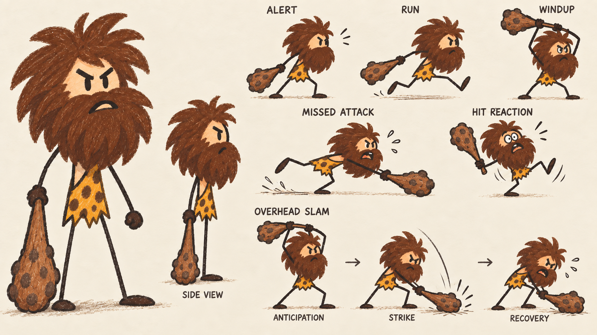
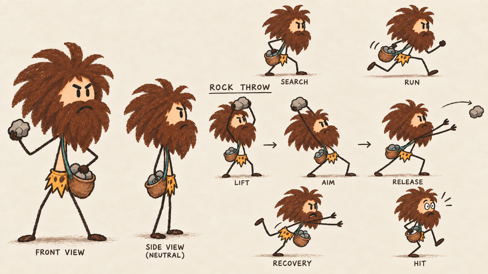
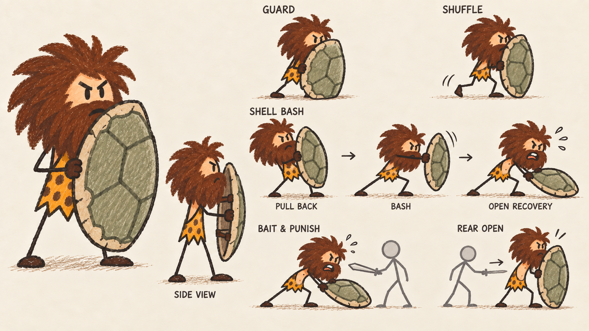
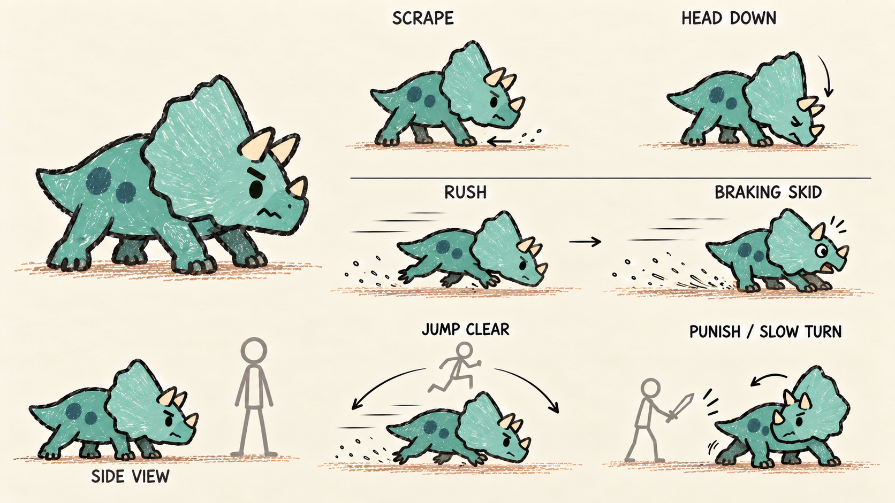
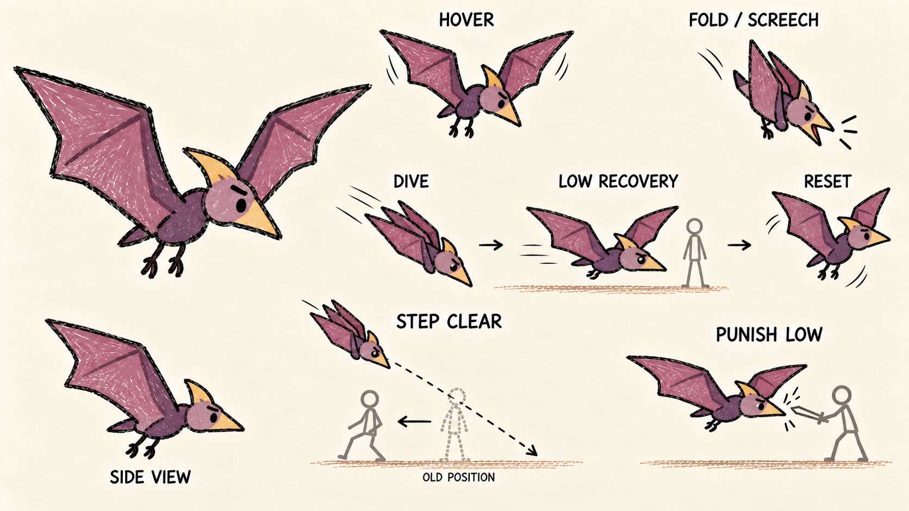

# Prehistoric enemy reference shelf

Curated concept art for the [enemy roster](../../../../docs/prehistoric-enemies.md).
These sheets are design inputs, not runtime images.

**Five of six core enemy roles have reference art.** Tar spitter (area controller)
is the remaining gap. Browse the sheets below; gameplay implementation status
is tracked separately in the enemy roster.

| Folder | Curated source | Selection |
| --- | --- | --- |
| `club-caveman/reference.png` | `output/imagegen/club-caveman-childlike-v2.png` | User's preferred club caveman design |
| `rock-thrower/reference.png` | `output/imagegen/rock-thrower-childlike-v3.png` | User's preferred rock thrower design |
| `shell-defender/reference.png` | `output/imagegen/shell-defender-reference.png` | Current defender concept |
| `baby-triceratops/reference.png` | `output/imagegen/baby-triceratops-charger-reference.png` | Current charger concept |
| `pterosaur/reference.png` | `output/imagegen/pterosaur-harasser-reference.png` | Current flying harasser concept |

All five were generated/edited using OpenAI's built-in image generation tool, as
recorded in the original prompt files. The three newer designs each have a
`reference-prompt.txt` beside their image. `reference-generation-prompts.txt` preserves
that file unchanged, including its separate raptor-rider section; preserving that
section does not select the rider design. Earlier references and intermediate
versions remain in `output/imagegen`.

Use stable enemy IDs as folder names. Keep the selected sheet named
`reference.png`; put later deliberately retained alternatives under `variants/`
and document their status here. Add each new selected enemy to the roster with
its role, tell, opening, and provenance. Keep disposable experiments out of this
curated source shelf.

## Club caveman — pursuer

## Rock thrower — ranged attacker

## Shell defender — defender

## Baby triceratops — charger

## Pterosaur — flying harasser

## Tar spitter — area controller

Concept sheet still needed. See the roster for its proposed attack and counterplay.
