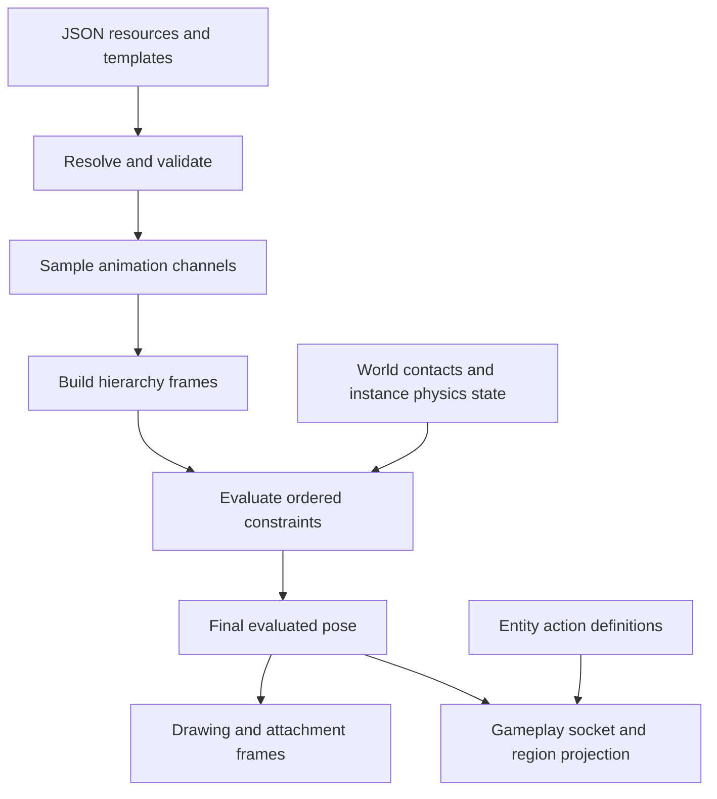

# Character resources and migration

For the current full migration proposal, see [Character system and Studio migration plan](character-system-migration-plan.md). It supersedes the future sequence below; this document retains the implementation history and current resource background.

Review and migrations: 2026-10-09. Resource-backed templates and the shared IK/contact layer are implemented. The later stages remain a proposed sequence.

Keep the existing authored pipeline and make its remaining assumptions explicit. Character Studio already has reusable model, animation, appearance and entity resources; replacing that pipeline would discard working authoring and playback behavior. The goal is that a new anatomy or content template needs data, while a new solver or rendering technique needs code.

## What exists

The authored library uses model format 5 (person.json is at 11 since P7c, every other model file stays at 5 and reads through the legacy reader), clip format 4 (every shipped clip since P7c: the 28 face-bearing Person clips through the face conversion, the other 63 through `--convert-clips`, which changed only their version and their empty face list), variant format 6 (every shipped file, since P7c), entity format 4 (P8c/P9a: `player`, `spear-guard` and `shield-defender` converted to attached colliders and typed behaviors; the other eight entity files stay at 2, which reads unchanged, as does 3), prop format 3, part format 1 (P5a, under `parts/`; animated payloads since P7a) and template format 1. The 2026-10-15 cleanup converted the 95 older model, clip and variant files once and removed automatic format upgrades. Paint coordinates are XY only. Point controls and IK chains remain native rig features alongside explicit bone frames and image slots.

Geometry is the actual shape or curve value, serialized with its `kind` and source parameters. Placement uses `scaleX`/`scaleY`, rotation, offsets and rig attachments; the same transform places outlines, picking and editable points. Shape dimensions belong to the geometry, including rounded rectangles. Appearance uses `material`, with `strokeWidth` for curves on both character parts and props (omitted values inherit the owning asset's line width). Parts and variants have no generic `width`/`height` fields. The 2026-10-17 migration updated checked-in models, variants and props once; older files must be converted explicitly. Prototype puppet format is now 3.

Surface paint belongs to `RenderMaterialDefinition2D`, alongside fill, outline, texture and tint. A model's `materials` dictionary holds shared definitions; a part or variant selects one with `"material": { "asset": "spotted-hide", "fill": "#b97549" }`. Inline fields override the named definition. Omitted `paint` inherits; `"paint": []` clears it. Paint stays in normalized shape coordinates and uses the existing clipping and deformation path. Character Studio's Material selector changes the reference, while edits under Surface paint update the shared definition for every user. Definitions are scoped to their model; no separate material catalog or hair/clothing class is needed.

| Concern | Current implementation | Remaining boundary |
| --- | --- | --- |
| Resource lookup | `AuthoredCatalog` scans folders and resolves IDs from JSON contents. | Specific game profiles still enumerate clip and equipment IDs in code. A folder or format identifier is a valid schema convention; a particular character's filenames should be content. |
| Rig | `CharacterModel`, `ResolvedModel`, `PoseEvaluator`: hierarchy, point controls, explicit bone frames, measures and sockets. | **Second migration implemented:** typed constraints and shared IK/contact evaluation, with separate compatible point and bone-frame solvers. |
| Templates | Previously selected by switches in `EditorSession` and `AssetBrowser`. | **Migrated in this change** to JSON recipes over existing models and clips. Build/proportion rules and appearance/entity presets remain code. |
| Animation | Separate clips; transform/target/socket-orientation tracks, contacts, markers, expressions, image attachments, slot colors and draw order. | One masked overlay is supported; a general layer stack, geometry deformation, image sequences and UV animation are separate features. |
| Appearance | Typed shapes/curves/materials, procedural parts, textured parts, slots/skins, props and local solid meshes. | `PuppetDrawing` currently requires image materials for slot-managed attachments. Shapes, images and props should eventually use the same attachment contract. |
| Contact | `ClipContact` and `ContactHold` operate on arbitrary constraint IDs and hold world anchors. Contacts now adapt to the shared pin operation. | A planted target is not a terrain query or a floor/wall collision solver. Surface queries, collision proxies and stateful simulation remain future operations. |
| Rendering | Orthographic XY projection with depth testing and local 3D prop orientation. `CharacterLayer2D` exposes depth as character order. | Slot order, continuous part depth and solid depth must retain their respective behavior when attachments are unified. |
| Gameplay | `EntityAsset` owns equipment, actions, health, activation windows with their damage, projectiles, the movement shape and, since P8, attached colliders (hurt, attack, guard, trigger) with stable ids, shared shapes and placement bindings, registered once per actor through `CollisionSystem2D`. | `PersonLoadout`, `PersonMoves`, controller vocabularies and the arena contain game/profile assumptions. Keep these above the reusable rig. The legacy hurt layout and inline window geometry remain readable until every entity converts (P9b/P11a). |

Motion and slot-color tracks use the shared [keyframe sampler](../App2d.Core/Animation/README.md). It owns ordered key
lookup, interval progress and held/exact endpoints; small struct policies keep each track's value and curve rules.
The existing authored key formats, independent component curves, absolute handles, full rotation turns and color
clamping retain their behavior. The primitive also supports unrelated value tracks without a character dependency.

Explicit bone channels use `Affine2D.EvaluateMatrix`, sharing channel-to-matrix math with the editable transform.
Sampling no longer clones an editor transform per bone. Setup channels, versions and notifications are untouched;
unchanged channels preserve exact cached matrices, including imported singular maps. Planar depth and local 3D prop
orientation continue through their existing frames.

Important code entry points:

- [Model and IK validation](../App2d.Core/Characters/Authored/CharacterModel.cs), [pose evaluation](../App2d.Core/Characters/Authored/PoseEvaluator.cs), [contact anchors](../App2d.Core/Characters/Authored/EntityAnimator.cs).
- [Drawing and the image-only slot restriction](../App2d.Core/Characters/Drawing/PuppetDrawing.cs), [orthographic renderer](../App2d.Core/Rendering/Characters/PointCharacterRenderer.cs), [world submission](../App2d.Core/Rendering/Renderer2D.Characters.cs).
- [Declared parameters and bindings](../App2d.Core/Characters/Authored/ModelParameter.cs) with their [compiled catalog](../App2d.Core/Characters/Authored/ParameterCatalog.cs); the Person's proportions are seeded as data by [PersonBuild.Declare](../App2d.CharacterSeeds/PersonBuild.cs) (P4a; no Core proportion rule remains), [loadout](../App2d.Core/Characters/Authored/PersonLoadout.cs), [player clip bindings](../App2d/Presentation/Persons/PersonAnimationDirector.cs).

Model format 8 (P4a) adds `parameters` and `presets` to a model. A parameter declares a stable `id`, `name`, `units` (`factor`, `length`, `radians`, `normalized`, `layer`), `default`, a hard `min`/`max`, an optional `softMin`/`softMax` editor range and `bindings`. A binding names its `kind` (`set`: the property takes the value; `scale`: `about + (reference - about) * value`, the reference being the target's own authored value or a named property's final value; `map`: a linear range mapping from `fromMin..fromMax` onto `toMin..toMax`), a `target` (`{ "control": id, "property": name }` or `{ "part": id, "property": name }`) and, for `scale`, an optional `reference` and `about`. Exposed control properties are `length` (bone nodes), `local.x`/`local.y` (unlinked nodes), `local.layer`, and `link.t`/`link.offsetX`/`link.offsetY` (linked nodes); part properties are the leaf fitting `scaleX`, `scaleY`, `offsetX`, `offsetY`. A property has one binding; the catalog refuses an affine-node target, an unknown owner or property, a second binding, a reference cycle and a default or preset value outside the range. A variant's `build` member holds parameter values by ID (its meaning is unchanged, so the variant format stays 4); resolution applies defaults, the variant's values, the bindings in dependency order, then the variant's explicit rest and part overrides, and only then derives positions, frames, fitting and measures. A version-5..7 model file reads unchanged; one naming the retired code `build` rule is refused by name (`models/person.json` was converted explicitly). Channel meanings are declared in `ChannelSemantics`: a `scale` track on a canonical node is one uniform pose scale (keys with equal x and y); shear remains the legacy affine adapter's artwork-fit channel.

Character seed generators live together in the `App2d.CharacterSeeds` library: prototype puppets, Person and creature templates, starter content, wardrobe art, fallback templates, player pose scripts, weapon art, spell clips and swing studies. It depends on Core; Studio, the game and tests reference it. Existing namespaces and generation commands are preserved. Core's editor session accepts optional seed factories, supplied by Studio, while authored models and appearance resources take priority. The authored JSON remains under `Assets/Characters/authored`; this reorganization does not regenerate it.

[`Humanoid`](../App2d.Core/Characters/Humanoid.cs) is the built-in humanoid vocabulary: plain string constants for controls, drawing parts, IK chains, groups, reference measures and attachment sockets. For example, `Humanoid.LeftHand`, `Humanoid.LeftForearm` and `Humanoid.HeadSocket` keep those roles explicit. The current humanoid has sockets and no image slots. The generic rig and evaluator continue to accept arbitrary IDs from resources; other anatomies define their own names. `PersonLoadout` retains the weapon, hair and animation marker IDs.

The shared `person` model now draws hands and bare feet on its existing controls. Its `skin` material supplies their
default color and the head's; variants with custom skin colors override the four extremity parts too. No controls or
animation structure changed. `left-hand-art` / `right-hand-art` follow the hand-to-elbow frame for gloves or cuffs;
`left-foot-art` / `right-foot-art` follow the foot-to-knee frame for footwear. Local +Y points up the limb, and +X points
toward the toes at rest. Both frames follow the evaluated pose, depth and character facing.

Footwear uses ordinary editable clothing props, with material and outline data in
`props/sandal-left.json`, `sandal-right.json`, `boot-left.json` and `boot-right.json`.
Cinder wears sandals and the maul brute wears short boots. To change a pair, replace the two foot equipment entries:

```json
{ "prop": "boot-left", "socket": "left-foot-art" },
{ "prop": "boot-right", "socket": "right-foot-art" }
```

Studio's **New > Appearance > sandal / boot** starts an editable left shoe. Duplicate it for the right foot and equip
each on its own socket; **Entity > Equipment** removes the old pair. Equipment prop IDs remain unique per entity,
so left and right shoes are separate assets sharing the same initial drawing. Hair, garments, footwear and weapons
remain independent equipment choices, while body surface changes use the existing materials. They can reuse one
model, animation set and controller; a combination needs no new C# enemy class. Weapon artwork alone does not change
an entity's attack clips, hit windows or damage rules.

Attached colliders (character-system migration, P8). An entity at version 3 declares `colliders`: each has a stable `id`, a `use` (`hurt`, `attack`, `guard` or `trigger`), a convex `shape` in authored units and one placement binding: a model `socket` (the clip's tilt/twist/turn applied and projected to XY, pushed `along` the axis), an equipped `prop` and `point` (`grip`, `tip`, `second-grip`, `muzzle`; `along`), a `control` with the socket rules (`frame`: the orienting control or `locomotion` for the screen axes; `toward`: local +Y toward another control, with `stretch` scaling the shape uniformly by the span over its rest length; `offsetX`/`offsetY`/`angle`), or none for the actor itself (`offsetX`/`offsetY` from the feet, +X toward facing). `enabled` is the default state (hurt, guard and trigger colliders start enabled; attack colliders are enabled only by windows) and `mask` the layers it may meet. Drawing layers never reach collision. A hit window names its attack collider with `collider` and keeps the activation interval `[start, finish)`, its damage and sound; the guard names a guard collider the same way. `ResolvedEntity.Colliders` is the one list every actor registers (`ActorColliders`, one `Collider2D` per collider with the owner's entity id and gameplay layer, moved from the authoritative pose every fixed step and never recreated); the arena's `AuthoredArena.Collision` and the game's physics world hold them, and the combat queries (`ColliderQueries`) run through the ordinary broad phase with both masks, the owner excluded and the use as the category. A version-2 entity file reads unchanged: its windows' inline geometry and its guard register as attack/guard colliders with the window's id (or `{action}-{window}` when several actions share one), and its hurt layout stays the legacy pose-derived box scan until the entity is converted. The conversion is explicit (`ColliderConversion`, CLI `App2d.CharacterSeeds -- --convert-colliders <authored-root> <output> <entity>...`, Studio **Entity → Hurt regions → Convert to colliders**): it writes a scratch tree with a report, keeps every attack and guard placement unchanged (verified at the windows' instants in both facings) and turns each hurt region into a box holding its rest-pose bounds, bound to the region's anchor control (its first control whose parent lies outside the region) in the screen frame, so the rest-pose region is reproduced exactly and the box then follows its anchor instead of being re-derived from every control; the report measures that drift per region. Converted: `player`, `spear-guard` (plus an authored `reach` trigger on the spear tip, reported by the arena as enter/exit facts) and `shield-defender`.

Typed behaviors (P9a). An entity at version 4 declares `behaviors`: `strikes`, one `StrikeDef` per hit group (a hit window's id, or an action's id for the projectile it fires) with integer `damage`, an optional `sound` asset id and an `impact` kind (`generic`, `sword`); `damage`, the `ReceiveDamageDef` with `health`, `mass` (divides knockback), `hurtSeconds` (the hurt expression and reaction after an accepted contact) and `staggerSeconds` (without a hit clip); `guard`, present when the entity guards, with its `openEvent` and `blockSound`; and `properties`, an extensible store of custom text values read by name. Each definition owns its defaults and validation, `BehaviorSchema` lists the fields with their kinds, ranges and help for Studio, and `ResolvedEntity.Damage`/`GuardBehavior`/`Properties` and `ResolvedHit.Strike`/`ResolvedAction.ProjectileStrike` are what gameplay reads; a strike for no hit group is reported at resolution, a hit group without an entry strikes with the defaults, and nothing is parsed during combat. Hit windows and projectiles carry no damage or sound at version 4 (a window's `damage`/`sound` and a projectile's `damage` are refused there); a version-2 or -3 file keeps them and its top-level `health`/`mass` as the legacy source of the same typed values. The conversion is explicit (`BehaviorConversion`, CLI `--convert-behaviors <authored-root> <output> <entity>...`): it moves the legacy fields into behaviors on a scratch tree with a report and verifies every resolved strike and receiving-damage value is unchanged. New entities from Studio's templates and the seeds' entities declare behaviors.

Contact resolution (P9b). `CombatContacts.Resolve` is the one resolution: an attacker's active windows against the targets their registered attack colliders overlap through the ordinary broad phase (the attack collider's own mask selects the targets' layers; an attached target's mask must accept the attack's layer, a plain body's mask is a physics setting and never keeps a strike off it), each target once per attack instance (the action sequence), hit group (the window id) and target through the `HitLedger`, with the target's enabled guard collider taking a front contact as a block. The result is `AcceptedContact` facts (window and strike, instance, target, position, the collider reached, blocked); gameplay applies them (the arena's hits, blocks, damage and reactions; the enemy's cue and the player's own reception), rejected contacts produce nothing and seeking never resolves anything. The arena, the authored enemies' attacks on the player and `CombatSystem2D` (the player's weapons, projectiles and tests; hit groups in its dedupe key `TryRegisterHit(source, attack, group)`, contact positions from the registered hurt collider reached) all run on it; the legacy hurt scan survives only for entities whose hurt is not registered. `CombatImpactKind2D` comes from the swing's strike. Intended repeated pulses are different hit groups of one attack instance.

BoilerBrute and GreenDinosaur world placements use the authored `maul-brute` and `stalker-pest` entities through `AuthoredEntityEnemy2D`. Their old gameplay classes, sprite views and hammer-specific messages are removed; missing authored entities produce an error. Presentation uses the same authored final pose and `EntityCue2D` events as other authored enemies. The placement IDs remain compatible with saved maps. Shieldback and Rival still have code-defined fallbacks when their authored entities are absent; those paths remain supported.

Passive physics props load from `physics-props/*.json` into `AuthoredCatalog.PhysicsProps`. The first is
[`dumbbell.json`](../Assets/Characters/authored/physics-props/dumbbell.json): its `shape` is a composite of one rectangle and two circles,
shared by collision and presentation. Geometry uses the existing tagged shape JSON directly. Composite `parts` must be nonempty
and convex; their coordinates, and all physics-prop settings, use game world units rather than character model units.

`body` holds plain `PhysicsBodySettings2D` data: motion type, mass, moment of inertia, rotation locking, gravity scale,
friction and restitution. Settings validate before `CreateBody` registers the live body and collider in `PhysicsWorld2D`.
The spawning world supplies identity and collision layers. `fill` is a solid `#RRGGBB` color; `hitVelocityScale` and
`hitAngularKick` configure the response to a registered strike. Physics props are currently passive and indestructible.
They need no character model, skeleton or animation. Existing `tumble-prop` map placements spawn the catalog's `dumbbell`
through the shared `PhysicsProp2D` runtime; the old dumbbell-specific class and duplicated drawing shape are removed.

## First migration: resource-backed model templates

Studio now reads `Assets/Characters/authored/templates/*.json`. Recipes reference existing authored resource IDs, so there is no second copy of the geometry or animation keys. The New menu is populated from these files. Person, Quadruped, Triceratops and Stalker are included; Empty remains a built-in blank document.

For example, a custom model with no human body parts can become a template:

```json
{
  "format": "app2d-model-template",
  "version": 1,
  "id": "oscillator",
  "name": "Oscillator",
  "description": "A machine rig with one repeating movement.",
  "model": "machine",
  "animations": { "swing": "source-performance" },
  "previewAnimation": "swing"
}
```

The example requires an authored base model whose ID is `machine` and a compatible clip whose ID is `source-performance`. IDs come from the documents; the filenames need not match. Reopen the workspace after adding or changing a recipe.

Creating `crank` from that recipe makes `crank` and `crank-swing` as independent unsaved documents. The animation map's **keys are new ID suffixes**, and its values are source clip IDs. `previewAnimation` names a suffix and is optional. Every clip used by the source model's motion sets must be included; creation reports an omitted dependency instead of leaving a broken reference. Several roles can still share one copied clip.

Creation uses the current source documents, including valid unsaved edits. It deeply copies geometry, materials, hierarchy, sockets, skins, groups, looks and animation data. It remaps only model/clip references and motion-set assignments. Control/slot/marker IDs, reference measures, contacts, depths and imported provenance retain their meanings. Texture paths continue to refer to shared images in the same authored root. The new model and its clips start together at structure revision 1.

All generated IDs, references and clips are checked before any drafts are inserted, including conflicts with files that failed to load. No source document or existing asset file is rewritten. Save all persists the new documents using the existing per-file atomic saves; it remains a sequence of saves, not a multi-file transaction. New Person models now include seven compatible starter clips, fixing the old creation path's motion sets pointing back to clips for the original Person model.

Template IDs have their own namespace, so template `person` can reference model `person`. Invalid recipes appear in the browser's unreadable-file diagnostics. A custom workspace can omit the templates folder; Empty still works. To use a recipe in another workspace, bring its source model, referenced clips and any images along with it. Templates are edited as JSON in this first step; a template inspector is not implemented.

This change does not replace the old content-generation commands. `PersonTemplate`, `QuadrupedTemplate`, `StarterContent` and the move generators remain explicit authoring/regeneration tools and test fixtures. Ordinary Studio model creation no longer calls the anatomy generators.

## Second migration: typed IK and contact evaluation

Model format **4** includes `constraints`. Loading requires the current format, and saving writes it. The `chains` collection supplies point IK; animation `target` tracks and `contacts` keep their IDs and meanings. Recipes copy constraints along with their clips.

Format **7** (character-system migration, P3a) keeps one `constraints` list only: a point chain is a `two-bone-ik` entry with `"solver": "point"`, and `LegacyModelReader` folds an older file's `chains` into the front of `constraints`. Each control declares its `node` kind: `point` (the default; `rest`/`restAngle` are character-frame values the resolver turns into a parent-local similarity), `bone` (canonical: `local` = `{ x, y, rotation, scale, reflect, layer }`, `length`, optional `link` = `{ t, offsetX, offsetY, orientation }` binding the origin to the parent bone; `rest` is derived and not written) or `affine` (the legacy `transform`, kept for the native wheel fixture and curve-face's scaled eyes). The resolved model exposes the compiled graph as `ResolvedModel.Nodes`; `PoseEvaluator` composes every node as `nodeInCharacter = nodeLocal * parentInCharacter` and writes positions, frames and angles together.

For example, this complete minimal model is a machine linkage with two rigid segments and an endpoint:

```json
{
  "format": "app2d-model",
  "version": 4,
  "id": "linkage",
  "name": "Linkage",
  "controls": [
    { "id": "beam", "length": 1, "transform": {} },
    { "id": "hinge", "parent": "beam", "length": 1, "transform": { "x": 1 } },
    { "id": "tool", "parent": "hinge", "transform": { "x": 1 } }
  ],
  "constraints": [
    { "kind": "two-bone-ik", "solver": "bone", "id": "reach",
      "root": "beam", "joint": "hinge", "end": "tool", "bend": 1 }
  ]
}
```

Attach shapes to `beam`, `hinge` or `tool` through the existing part frame binding. A `target` track on `reach` with offset `(-1, 1)` places the endpoint at `(1, 1)`; zero offset targets its resolved rest position. The default target frame is `locomotion`, and the default reference scale is `unit`. The selected endpoint can have its own length, artwork and descendants; only the first two controls supply the solved segment lengths. Studio creates this declaration with **Make IK constraint** when the selected endpoint follows two bones. The existing `AddChain` API still authors legacy point chains; JSON may also put a `two-bone-ik` entry with `solver: "point"` in `constraints` to adopt the typed collection without changing its behavior.

`CharacterModel.IkChains` presents both collections to authoring. `ResolvedModel.IkConstraints` fixes evaluation order: legacy chains first, then typed constraints, each in document order. IDs must be unique across both. Null/unknown kinds, unknown solvers, overlapping or nested writers and target frames moved by any constraint are rejected. This initial layer deliberately rejects dependencies it cannot solve; it does not imply support for an arbitrary iterative constraint graph.

`PoseEvaluator` still samples channels and masks and builds FK. It then supplies typed `RigIkTarget` operations followed by active `RigContactPin` operations to [RigConstraintEvaluator](../App2d.Core/Characters/Authored/RigConstraintEvaluator.cs). Other hosts can use this same graphics-free layer on an evaluated hierarchy. Contact activation remains half-open, with the held non-looping endpoint exception. The existing world-anchor callback runs only for fully held contacts; a masked action releases its pin toward the blended IK target before the solve. There is no persistent simulation state in this evaluator, so seeking and onion skins stay deterministic.

The point solver retains rest-distance lengths, translated descendants, rotation-only target frames and the old reach inset. Bone IK instead:

- Requires the joint and endpoint to meet their parent's declared +X tip. Both declared segment lengths must be at least 0.01. It uses the current scaled root/joint lengths and exact reach limits, so a fully extended rest pose stays straight and equal segments can fold onto their origin. A stable FK direction resolves the otherwise ambiguous fully folded pose, including reflected contact pins.
- Rotates the root and joint frames and propagates each change through descendants. Points, angles and matrices remain consistent for geometry, sockets and gameplay projection. Depth retains the existing convention: joint depth stays unchanged, while the endpoint and its descendants follow target depth. Socket offset units retain their existing rotation-only convention; this migration does not change the socket schema into an affine attachment.
- Supports uniform XY scale and reflection. Bend follows the root frame's handedness. Segment frames with shear, unequal axis magnitudes, collapse or world lengths below 0.01 produce a diagnostic naming the constraint and segment. Setup, variant and sampled poses are checked. Animation that crosses a collapsed scale is unsupported even if its endpoints are valid.
- Uses the full transform of a free target frame. Offsets are in that frame's local axes (with the selected reference-measure ratio applied); authoring uses the inverse transform when dragging. A collapsed target frame cannot be used. Locomotion-frame targets and contact offsets remain in model units.

The root's translation and supported scale can still be animated. Its rotation is owned by IK; direct transform tracks on the solved joint/endpoint remain disallowed, as with point chains. An endpoint's setup orientation and descendant animation travel with the solved joint. Bone length editing moves the connected IK joint to the new tip. A variant that independently pulls a joint away from a declared tip is rejected instead of silently changing the meaning of `length`.

Point-library retargeting and prototype motion conversion do not infer bone rotations yet; they report that limitation for a bone-constrained target model. Noodle's existing rest export can now receive a Studio bone constraint when its tips connect. A new Noodle check verifies that its exported bones and attachments match a known pose through this same solver. Noodle's procedural runtime and deforming skin remain future ports.

## One reusable rig, several ways to drive it

Quadratic and cubic Bézier parts now accept the same `bindings` as cutouts. Their point indices are start, handle(s), end: 0/1/2 for a quadratic and 0/1/2/3 for a cubic. Each bound point preserves its drawing offset from a named control's rest frame; `toward` optionally rotates that offset. Unbound points keep following the ordinary two-endpoint curve frame. Curve XY and character layer order use the same Bézier weights. No face names or expression channels are needed.

Choose **New → Model: Curve face template** and play **Expressions — play me** for a tour. Its nine clips include smile, blink, wink, angry, worried, surprised, crossed eyes and traveling hair bumps. The two curves around each eye flatten into a blink or straighten into the two lines of an X. Two mouth curves can share a bend for a smile or separate into an open mouth. Brows use the same point attachments. These are ordinary translation and scale tracks, with no expression-specific renderer. The existing human face presets are still available. Since P7b the same face exists as the reusable animated part `parts/face-curve.json` (converted by `FaceConversion`, `--convert-face`): its eyes are point controls and the pupil squash is a `fit` track; instance it on any socket, select its words (`smile`, `blink`, `wink`, `angry`, `worried`, `surprised`, `crossed-eyes`, `hair-wave`, `expressions`, `neutral`) from a clip's `plays` or a gameplay request, and the `blink` layer keeps blinking on the actor's clock underneath.

Select a curve in rig editing, expand **Edit curve handles**, and use **Follow** to change attachments. The **Geometry** field switches between library shapes and curves; detach point bindings before replacing their geometry. Parts store the geometry definition and material directly, with no separate character kind or stroke flag. Existing native model JSON already uses this format. **Normal wave** adds a typed `wave` modifier (`CurveWave`: `amplitude`, `cycles`, optional `phaseControl`) to a linked curve, evaluated through the existing `NormalOffsetCurve2D`; shapes and other parts carry no wave fields. `phaseControl` names a normal rig control: translating it along the endpoint span carries the sine bumps along the curve. Heights are relative to that span, negative heights use the other normal direction, and character layer order remains unchanged. The modifier owns its limits and control references, so deleting its phase control is refused until the wave is detached. The hair study demonstrates this with a cubic curve and one translation track. Sampling and picking share the deformed path. Model files at version 5 kept the wave as loose `waveAmplitude`, `waveCycles` and `wavePhaseControl` part fields; `LegacyModelReader` (the one compatibility boundary for model files below the current version) converts them on read and the file is rewritten at the current version only when saved.

A face is an animated library part instanced on a socket (character-system migration, P7c); the shared part type carries no face field and the generic evaluator knows no expression vocabulary. The Person wears `parts/face-person.json` as the instance `face` on `head-art` (`"attachments": [{ "id": "face", "asset": "face-person", "socket": "head-art", "x": 0.065, "fitX": 0.56, "fitY": 0.58, "layer": -0.122, "expression": "relaxed" }]`, the fit bound to the `head` parameter like the head part itself, policy `stretch` so the features scale with the head as the old drawing did). That asset is what the retained procedural generator bakes (`ProceduralFace` in App2d.CharacterSeeds, `--bake-face <authored-root>`): sixteen named poses in one `expressions` clip (each word held at its own second), a `blink` clip looping on an eye-only layer with the actor's clock, lids, pupils, whites, crossed-eye marks, brows and two mouths as ordinary pieces shown through `show` keys and squashed through `fit` keys. A clip selects the face with `plays` keys on the instance (`none` hides it for a back view; the 28 Person clips that carried face tracks were converted this way), a variant or look sets the instance's `expression` (the attachment property; brute's `angry`, the `ember` look's `determined`), and gameplay asks for a word (`PoseInput.Expression`: the Person presentation's reaction state, an enemy's `hurt`/`knocked-out`) which the asset maps or leaves alone if it does not bind it. Model format **11** carries no face on a part: a file at versions 5 to 10 with a face word or payload, a version-3 clip with `faces` tracks and a legacy variant with a part face word are refused by name and convert explicitly with `FaceConversion.ConvertPayload` (`--convert-face-payload <root> <model> <part> <instance> <asset> <socket> <output>`), which rewrites the model, its clips, its variants and its looks on a scratch tree with a report and verifies each clip's selection against the face track it held.

An animated library part (character-system migration, P7a) declares `"payload": "animated"` and carries a small rig of its own (`controls`, `constraints`, `groups`, ordinary model data compiled by the same evaluator), its own `clips` (authored against the part, `model` = the part ID), `layers` (the first is the base and owns everything; each later one names a group as its `mask`; every layer declares its `clock`: `shared` runs on the wearer's clip time, `mapped` on `offset + rate × time`, `local` on the actor's continuous clock so a blink never restarts with a walk; a layer may `play` a clip by default), the targets it `exposed` to a wearer's clips, and `expressions`: semantic words bound to what the asset does (`clip` on a `layer`, a `time` to hold as a pose, `hidden`, layers it `mutes`); `expression` is the asset default and an instance may set its own (`attachment.expression`, a variant property). `fitting` says what an instance's fit does to the composite: `stretch` (the P5 behavior, the whole artwork as one leaf deformation) or `layout` (the controls and locations reposition; each piece keeps its size). A wearer's clip reaches in with namespaced tracks, `"target": "face/left-brow"` (translate, rotate, scale, bend, and the part channels `fit` and `show` on pieces), which the clip validates against the asset's exposed list with the reference path to the offending resource, and selects expressions with `plays` keys (`{ "instance": "face", "keys": [{ "time": 0.3, "expression": "smile" }] }`, held; `none` hides the instance). A gameplay request (`PoseInput.Expression`, or a `PartPlay` with its own seconds) wins over the channel, which wins over the instance and asset defaults; a masked wearer layer that names the instance in its group owns its selection and keys from half weight. The instance's evaluated pose joins the wearer's (`EvaluatedPose.Attachments`): drawing, picking, contours and the Studio handles read it through the instance placement, and seeking is pure (part clips carry markers for their own authoring but dispatch nothing). `fit` and `show` tracks are ordinary part channels on the wearer too: `fit` keys multiply a part's leaf scale (`1 + value`, the explicit artwork-fit channel that replaces rig scale for a pupil squash), `show` keys hold 1 or 0. In Studio the animation outline lists each animated instance with its exposed targets, the control inspector keys a nested control or a piece's fit and visibility through the namespaced channels, the timeline shows the `Part` rows, the attachment inspector sets the instance's default expression (with provenance on a variant) and the part editor shows the payload's rig, layers, bindings and exposure toggles.

Joint limits (character-system migration, P4b) are declared on a bone node: `"limit": { "min": -1.57, "max": 1.57 }` (`RigLimit`, radians) bounds its parent-local rotation, so a reflected parent or a mirrored actor never inverts the convention; the rest rotation must lie inside the range, and a node solved by a point constraint cannot carry one (the point solver turns no frames). An ordinary `rotate` channel keeps its authored angles and is held at the bound, with the state in `EvaluatedPose.Limits`; the new `bend` track kind (`ChannelSemantics.NormalizedParameter`) maps key x in 0..1 onto [min, max] exactly at both ends, owns the node's rotation in that clip (a `rotate` track on the same node is refused) and changes meaning when the limits change, by design. The canonical bone solver is limit-aware: when the analytic pose crosses a bound it holds that rotation at the bound and aims the rest at the target, returning the closest in-range pose; `ChainResult.Reached` is residual-based for every solver (within 1e-4 of the target), so a clamped, folded or held pose reports its gap instead of claiming the target. A variant overrides `limit.min`/`limit.max` on a bone node that declares a limit; a node without one exposes no limit property and says why. The model format stays at 10 and the clip format at 3: both members are new optional ones that leave every existing file's meaning unchanged.

A joint should not need to become a different object type when switching from keyed motion to IK or physics. Separate the stable structure, what draws on it, and what drives it:

| Resource / component | Responsibility |
| --- | --- |
| Rig | Stable bone/control IDs, parent relationships, setup transforms, optional lengths, point bindings, sockets and semantic roles. |
| Geometry | Shapes, curves, point lists, rigid meshes and, later, weighted meshes. A point list describes geometry or sampled motion; it is not a competing skeleton type. |
| Material / image | Fill, outline, texture reference and tint. Add texture sequences or UV channels when implemented. |
| Attachment | Bind geometry/material or a prop to a frame; select visibility, skin and draw order. A rigid attachment moves with its frame; a deformable one needs explicit bindings/weights. |
| Animation | Tracks address declared controls, constraint parameters, slots and attachment/material channels. Whole-rig motion is a root track; independent motion uses masks/layers. |
| Constraint | A typed operation with explicit references, parameters, coordinate space, weight and ordering/dependencies. Examples: IK, pin/contact, angle/distance limits, path following and collision avoidance. |
| Template | A recipe producing independent assets. A variant remains the existing live reference to one shared base plus overrides. These are different reuse choices. |
| Entity / game profile | Selects a rig, movement and actions, loadout, hit shapes and damage rules. A sword's artwork does not need health or an AI controller. |

Keep `CharacterModel` as the compatible document envelope during migration. Geometry and materials can stay embedded until actual reuse calls for separate resources. There is no need to introduce a new package ecosystem or an expression language to start.



Constraints need a defined solve order and frame propagation. Updating an IK endpoint must also update the affected frames, descendants and attachments. A floor and a wall can be instances of the same surface constraint with different normals. Self-intersection needs chosen proxy shapes, collision masks and exclusions for connected bones; an iterative solve must balance those contacts with length/angle constraints and report residuals when they cannot all be satisfied. Automatically colliding every visible shape would constrain intentional overlaps and hide the real authoring controls.

Pure animation sampling must remain safe for seeking and onion skins. Stateful physics belongs to each rig instance at a fixed time step, with explicit initialization/reset and a defined replay or bake policy for seeking. Constraints may consume a world-query interface; they should not directly know the side-scroller or editor. Decorative secondary motion can remain presentation-only, while anything controlling hit regions needs an explicitly shared authoritative evaluation path.

## Why Noodle is separate today

Noodle contains three experiments, not just another frontend for Studio:

- `--bones`: `RigDocument2D` and the WinForms bone/shape editor. Its one-way [bridge](../App2d.Noodle/Rigging/RigAuthoredBridge2D.cs) exports a rest model at 100 pixels per authored unit. Both paths share `BoneFrame2D`; this is already a partial integration.
- `--rigid`: `StandardSkeleton2D`, `RigidPose2D`, `PoseClip2D`, procedural locomotion and rigid/spline artwork. The skeleton's anatomy and proportions are fixed in code and this mode has its own pose/animation representation.
- `--prototype`: `NoodleArm2D` and `NoodlePerson2D`, including a width-reconstructed skin around a two-bone solve. That deformation technique has not been made into a reusable Studio attachment.

The projects already share Core's IK/math, shapes, rendering and constraint projection functions. Distance/axis/polar projectors are wrappers around Core math, not three new full physics solvers. The duplication is primarily document representation, pose orchestration, content and parts of skin generation.

The bone bridge exports neither animation nor constraints/physics. Collision-only shapes become hidden artwork, not gameplay colliders, and alpha is omitted. Keep those limits explicit during import. Bring Noodle's useful deformation and authoring interactions onto the shared rig/attachment contracts, then make the demos consume that runtime. Retain the demos as useful test hosts; retire duplicate pose engines only after parity checks pass. See [the existing bridge notes](rig-bridge.md).

## Remaining migration sequence

| Stage | Concrete change | Compatibility gate |
| --- | --- | --- |
| 1 — implemented | Data-backed model templates and dependency remapping. | Existing resource files stay unchanged; new bundles save/reopen independently; source and copy poses match. |
| 2 — implemented | Typed IK resources, shared target/contact operations, compatible point evaluation and bone-frame IK with explicit scale/reflection rules. | 18,225 captured legacy samples match exactly; bone tests cover frames, attachments, contact release, reflection, reach boundaries, saving and editing. |
| 3 — attachments | Let slots bind procedural geometry and props as well as images. Add data-backed attachment selection/socket switching. | Preserve part depths, slot timelines, weapon grip/tip projection, skin fallback and both facings. Keep texture swaps distinct from future UV/deform support. |
| 4 — profiles | Move Person loadout IDs, source mappings, proportion bindings and player clip assignments into explicit templates/profiles. Retain specialized controllers behind named capabilities. | Existing player moves, clothing, sheathing, attacks, hit timing and enemy behavior still match. Gameplay owns damage; rendering remains observational. |
| 5 — Noodle | Make bone editing use the shared document; adapt rigid/procedural clips and port noodle skin generation as a reusable attachment/deformer. | Bridge rest/rotation checks plus matched samples for each demo; preserve originals until conversion is reviewed. |
| 6 — extensions | Add floor/wall queries, self-collision, secondary physics, weighted meshes and richer animation layers as independently testable features. | An arbitrary machine/creature rig exercises each feature without requiring human part names. Define editor seeking behavior before adding physics. |

Preserve stable IDs, motion reference measures, coordinate conventions, interpolation/easing, contact endpoints, draw order and action timing. Load-time adapters should not rewrite source assets. Any later on-disk conversion should target a copy first, report unsupported data, and pass save/reopen plus pose/region/render comparisons before replacing originals.

Useful existing validation includes authored catalog/pose/entity tests, bone and slot tests, `App2d.Noodle --check`, and Studio's editor/motion/entity/weapon/wardrobe smoke modes. Automated pose parity complements image comparisons: neither alone covers both contact/gameplay behavior and occlusion.

## Validation of the template migration

- Baseline: all 1,368 existing tests passed before the change.
- The five-project solution builds. The 39 focused template, editor-session and quadruped tests pass, including 19 new template cases.
- Final full regression run: **1,387 passed, 0 failed, 0 skipped**. An earlier full run failed the unchanged `MusicPerformanceTests.ZoneUpdatesAndSelectionsAllocateNoManagedMemoryAfterWarmup` allocation assertion (7,872 bytes versus zero). It passed in isolation and in the final full rerun; no audio code or test thresholds were changed.
- Noodle's deterministic `--check` passed both the rigid prototype and authored rig bridge checks.
- Studio's `--smoke-editor` passed 44 checks and produced 33 frames on a fresh scratch workspace. The copied Triceratops model and rush animation frames were also inspected visually.
- Git inspection confirmed no changes to existing model, variant, animation, prop or entity resource files. Only the new `templates` resource folder was added to the character library.

The local smoke output and regression report are under `artifacts/character-resources-20261009` (ignored build artifacts).

## Validation of the constraint migration

- The five-project solution builds. Final regression run: **1,424 passed, 0 failed, 0 skipped**, including 37 new cases for constraints and exact IK geometry.
- Before modifying the evaluator, a local harness captured **18,225** pose fingerprints across every shipped model/variant and compatible clip. Samples cover repeat/clamp, contact boundaries, in-place motion, a held-target callback, reversed channels and partial/full masks. After the final changes, every fingerprint matches exactly, including points, angles, bone matrices, socket orientations and constraint/contact results.
- Bone cases check analytical segment positions, attachment and descendant propagation, socket orientation, uniform scale, all reflection combinations, fully extended/folded configurations, unreachable targets, contact release, inverse target authoring, seeks, length edits, template copying, strict JSON parsing and editor save/reopen/undo. Unsupported frames and competing writers produce explicit errors.
- Noodle's deterministic `--check` passes, including a newly added exported linkage that uses the shared bone constraint evaluator and matches Noodle's known bone/shape transforms.
- Studio's final `--smoke-editor` passes **48 checks** and renders **36 frames** on a fresh scratch workspace. The new linkage workflow creates a typed constraint, keys it, plants it and saves/reopens it. Rest and animated frames were inspected visually.
- Git whitespace checks pass. No existing model, variant, animation, prop or entity resource file was rewritten.

Local evidence is in `artifacts/rig-constraints-20261009`: the parity harness and baseline, `tests/regression-final.trx`, and `editor-final/editor-smoke.txt` with rendered frames. These are ignored artifacts; the automated constraint and Noodle checks remain in source.
