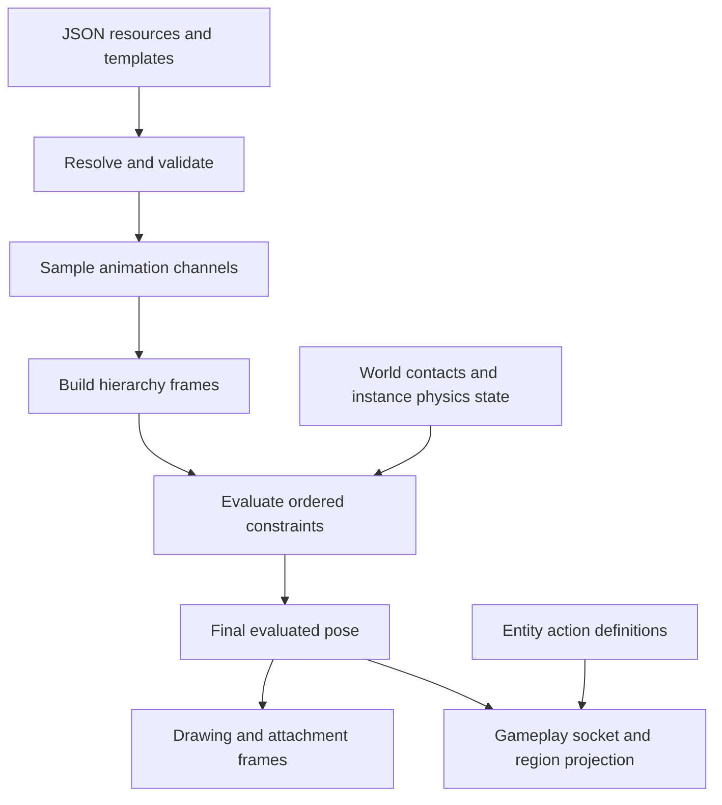

# Character resources and migration

Part consolidation (completed 2026-10-27): `Part` is the shared authored definition and `PartInstance` is one occurrence. Part format **4** stores one `geometry` array of `PartGeometry` entries. An entry has either planar `geometry` (shape/curve; a material can texture a rectangle) or a `mesh` with vertices/triangles and an optional extrusion outline/thickness. Both use the same placement, material, visibility and animation targets. Physical mesh Z is distinct from an entry's drawing-layer `depth` and the instance's `layer`. `CharacterModel.Parts` uses the same entry type within its existing rig schema.

All committed bundles use the current formats. Ordinary open/save rejects old versions and unknown fields. The temporary format converters and their CLI have been removed after verification; Git history retains the conversion code and original files. See [the completed consolidation plan](part-consolidation-plan.md) for the migration ledger.

S2 (2026-10-27) also moves all clothing and weapons into this shared library. `PropAsset` and its separate catalog/codec are gone. Named `locations` contain grip/tip/muzzle or arbitrary XYZ points; `pivot` and `scale` preserve authored geometry coordinates. Physical location `z` and shape/curve `depths` are separate from drawing layers. Equipment, library previews, geometry editing and OBJ import use the shared part path. There is no separate props loader. Asset IDs and gameplay bindings remain unchanged.

S4 (2026-10-27) removes `EntityAsset`, `EntityBehaviors`, `MovementDef`, `ColliderDef` and the separate entity folder/catalog store. The eleven characters are Parts in `parts/`, referencing their existing rig through `model` and their shared equipment through `equipment`. Optional `behavior` owns controller, motion-set/role assignments, actions/events/windows, strikes, receiving damage and guard policy. Its `movement` ID and `colliders` ID-to-role map refer to entries in the Part's `geometry` array. Entries with `collision` and no `material` remain invisible; adding a material uses the same animated placement for drawing and collision. `damage.knockbackResistance` is independent of physical body mass. Passive Parts have no Behavior or combat registration. `AuthoredCatalog.Entities` remains a compiled gameplay view of the shared Parts, and Studio's Entity workspace edits those same Part documents.

S6 finishes the cutover: 50 library Parts and eight level-local platform Parts use version 4. Collision comes only from marked geometry entries; the separate root collision member is gone. Ten physical assets explicitly mark their existing shapes, preserving their units, placements and body settings. The game face and the centaur's person-upper/quadruped-lower dependencies remain supported.

S5 adds geometry `tint` and `alpha` clip tracks using the same keys, curves, masks and namespaced bindings as existing fit/show tracks. Tint keys use RGB in `value`; alpha uses `value.x`, with values in 0..1 multiplying the material. Material `alpha` defaults to 1. `textureAnimation` holds `frames` (`texture`, `seconds`, optional `source`) and `loop`; an empty frame list explicitly clears an inherited sequence. A source region has normalized `x`, `y`, `width`, `height` measured from the image's top left. A frame's omitted region inherits the material's region; an explicit full region selects the whole image. World rectangle size and anchor remain geometry data regardless of source image dimensions. Frames and pose channels sample supplied time through the existing frame/key samplers and playback rules; seeking does not step simulation or emit events. `Part.Motion` remains the separate kinematic/visual path configuration.

The completed [character migration](character-system-migration-plan.md) and [Part consolidation](part-consolidation-plan.md) record the implementation history. The resource contracts below describe the supported authoring paths.


Keep the existing authored pipeline and make its remaining assumptions explicit. Character Studio already has reusable model, animation, appearance and entity resources; replacing that pipeline would discard working authoring and playback behavior. The goal is that a new anatomy or content template needs data, while a new solver or rendering technique needs code.

## What exists

Current formats: model 12, clip 4, variant 6, Part 4, template 2 and game profile 1. Model/variant envelopes retain the canonical rig and parameter machinery; Parts own reusable geometry and optional gameplay configuration. Retired entity, prop, physics-prop and object formats have no loader or converter. Animation uses uniform pose scale and explicit leaf fit; there is no affine/shear compatibility branch.

Geometry is the actual shape or curve value, serialized with its `kind` and source parameters. Placement uses `scaleX`/`scaleY`, rotation, offsets and rig attachments; the same transform places outlines, picking and editable points. Shape dimensions belong to the geometry, including rounded rectangles. Appearance uses `material`, with `strokeWidth` for curves on both character parts and props (omitted values inherit the owning asset's line width). Parts and variants have no generic `width`/`height` fields. Checked-in models, variants and Parts use the current schemas; other versions are rejected. Prototype puppet format is 5.

Surface paint belongs to `RenderMaterialDefinition2D`, alongside fill, outline, texture and tint. A model's `materials` dictionary holds shared definitions; a part or variant selects one with `"material": { "asset": "spotted-hide", "fill": "#b97549" }`. Inline fields override the named definition. Omitted `paint` inherits; `"paint": []` clears it. Paint stays in normalized shape coordinates and uses the existing clipping and deformation path. Character Studio's Material selector changes the reference, while edits under Surface paint update the shared definition for every user. Definitions are scoped to their model; no separate material catalog or hair/clothing class is needed.

| Concern | Current implementation | Remaining boundary |
| --- | --- | --- |
| Resource lookup | `AuthoredCatalog` scans folders and resolves IDs from JSON contents. | Specific game profiles still enumerate clip and equipment IDs in code. A folder or format identifier is a valid schema convention; a particular character's filenames should be content. |
| Rig | `CharacterModel`, `ResolvedModel`, `PoseEvaluator`: hierarchy, point controls, explicit bone frames, measures and sockets. | **Second migration implemented:** typed constraints and shared IK/contact evaluation, with the canonical bone-frame solver and point controls for authored targets. |
| Templates | JSON recipes read by `EditorSession` and `AssetBrowser`. | Recipes reference existing models and clips. Build/proportion rules and appearance/entity presets remain code. |
| Animation | Clips, masked layers, exposed Part targets, held selection, tint/alpha, timed images and atlas regions share sampling and playback rules. | Stateful simulation remains separate from pure seeking. |
| Appearance | One Part geometry collection and drawing path for shapes, curves, images and meshes, with optional material and collision. | Slot/skin timelines retain their existing native-rig contract. |
| Contact | `ClipContact` and `ContactHold` operate on arbitrary constraint IDs and hold world anchors. Contacts now adapt to the shared pin operation. | A planted target is not a terrain query or a floor/wall collision solver. Surface queries, collision proxies and stateful simulation remain future operations. |
| Rendering | Orthographic XY projection with depth testing and local 3D prop orientation. `CharacterLayer2D` exposes depth as character order. | Slot order, continuous part depth and solid depth must retain their respective behavior when attachments are unified. |
| Gameplay | `Part.Behavior` selects actions, roles and collision entry IDs; `Part.Equipment` selects ordinary Part instances. `ActorColliders` registers gameplay colliders once through `CollisionSystem2D`. | `PersonLoadout`, `PersonMoves`, controller vocabularies and the arena contain game/profile assumptions. Keep these above the reusable rig. |

Motion and slot-color tracks use the shared [keyframe sampler](../App2d.Core/Animation/README.md). It owns ordered key
lookup, interval progress and held/exact endpoints; small struct policies keep each track's value and curve rules.
The existing authored key formats, independent component curves, absolute handles, full rotation turns and color
clamping retain their behavior. The primitive also supports unrelated value tracks without a character dependency.

Explicit bone channels use `Affine2D.EvaluateMatrix`, sharing channel-to-matrix math with the editable transform.
Sampling no longer clones an editor transform per bone. Setup channels, versions and notifications are untouched;
unchanged channels preserve exact cached matrices, including imported singular maps. Planar depth and local 3D prop
orientation continue through their existing frames.

Important code entry points:

- [Model and IK validation](../App2d.Core/Characters/Authored/CharacterModel.cs), [pose evaluation](../App2d.Core/Characters/Authored/PoseEvaluator.cs), [contact anchors](../App2d.Core/Characters/Authored/EntityAnimator.cs).
- [Drawing and the image-only slot restriction](../App2d.Core/Characters/Drawing/PuppetDrawing.cs), [orthographic renderer](../App2d.Core/Rendering/Characters/PointCharacterRenderer.cs), [world submission](../App2d.Core/Rendering/Renderer2D.Characters.cs).
- [Declared parameters and bindings](../App2d.Core/Characters/Authored/ModelParameter.cs) with their [compiled catalog](../App2d.Core/Characters/Authored/ParameterCatalog.cs); the Person's proportions are seeded as data by [PersonBuild.Declare](../App2d.CharacterStudio/CharacterSeeds/PersonBuild.cs) (P4a; no Core proportion rule remains), [loadout](../App2d.Core/Characters/Authored/PersonLoadout.cs), [player clip bindings](../App2d/Presentation/Persons/PersonAnimationDirector.cs).

Models declare `parameters` and `presets`. Each parameter has a stable ID, units, default, hard/soft ranges and `set`, `scale` or `map` bindings to a control, geometry or attachment property. Validation rejects duplicate writers, unknown targets and dependency cycles. Resolution applies defaults, variant parameter values, bindings, then explicit overrides before deriving rig frames and measures. Pose scale stays uniform; nonuniform artwork dimensions use leaf fitting. `ChannelSemantics` records the supported track meanings.

Character seed generators live together in the `App2d.CharacterSeeds` library: prototype puppets, Person and creature templates, starter content, wardrobe art, fallback templates, player pose scripts, weapon art, spell clips and swing studies. It depends on Core; Studio, the game and tests reference it. Existing namespaces and generation commands are preserved. Core's editor session accepts optional seed factories, supplied by Studio, while authored models and appearance resources take priority. The authored JSON remains under `Assets/Characters/authored`; this reorganization does not regenerate it.

[`Humanoid`](../App2d.Core/Characters/Humanoid.cs) is the built-in humanoid vocabulary: plain string constants for controls, drawing parts, IK chains, groups, reference measures and attachment sockets. For example, `Humanoid.LeftHand`, `Humanoid.LeftForearm` and `Humanoid.HeadSocket` keep those roles explicit. The current humanoid has sockets and no image slots. The generic rig and evaluator continue to accept arbitrary IDs from resources; other anatomies define their own names. `PersonLoadout` retains the weapon, hair and animation marker IDs.

The shared `person` model now draws hands and bare feet on its existing controls. Its `skin` material supplies their
default color and the head's; variants with custom skin colors override the four extremity parts too. No controls or
animation structure changed. `left-hand-art` / `right-hand-art` follow the hand-to-elbow frame for gloves or cuffs;
`left-foot-art` / `right-foot-art` follow the foot-to-knee frame for footwear. Local +Y points up the limb, and +X points
toward the toes at rest. Both frames follow the evaluated pose, depth and character facing.

Footwear uses ordinary editable clothing props, with material and outline data in
`parts/sandal-left.json`, `sandal-right.json`, `boot-left.json` and `boot-right.json`.
Cinder wears sandals and the maul brute wears short boots. To change a pair, replace the two foot equipment entries:

```json
{ "prop": "boot-left", "socket": "left-foot-art" },
{ "prop": "boot-right", "socket": "right-foot-art" }
```

Studio's **New > Appearance > sandal / boot** starts an editable left shoe. Duplicate it for the right foot and equip
each on its own socket; **Entity > Equipment** removes the old pair. Equipment prop IDs remain unique per entity,
so left and right shoes are separate assets sharing the same initial drawing. Hair, garments, footwear and weapons
remain independent equipment choices, while body surface changes use the existing materials. They can reuse one
model, animation set and controller; a combination needs no new C# enemy class. Weapon artwork alone does not change
an entity's attack clips, hit windows or damage rules.

Gameplay colliders are collision-enabled Part geometry entries. Behavior names the movement entry and maps other IDs to hurt, attack, guard or trigger roles. Entries attach to a control/frame, socket, equipped Part location or root; offsets, angle, uniform scale and optional toward/stretch use the shared placement. `collision.enabled` and `collision.mask` configure participation. Attack windows select a collider for an interval; damage/sound stay in the strike behavior. `ResolvedEntity.Colliders` compiles convex gameplay shapes; `ActorColliders` registers them once and updates them from the authoritative pose. Drawing layer never changes collision.

Typed behavior includes `damage` (health, knockbackResistance, hurtSeconds, staggerSeconds), `strikes` keyed by hit group (damage, sound, impact), `guard` (collider, openEvent, blockSound), controller/action/role configuration, and custom `properties`. Physics mass remains on the body. The game and Studio arena use the same contact resolution and accepted-contact events; pure timeline seeking emits no combat or audio events.

Contact resolution (P9b). `CombatContacts.Resolve` is the one resolution: an attacker's active windows against the targets their registered attack colliders overlap through the ordinary broad phase (the attack collider's own mask selects the targets' layers; an attached target's mask must accept the attack's layer, a plain body's mask is a physics setting and never keeps a strike off it), each target once per attack instance (the action sequence), hit group (the window id) and target through the `HitLedger`, with the target's enabled guard collider taking a front contact as a block. The result is `AcceptedContact` facts (window and strike, instance, target, position, the collider reached, blocked); gameplay applies them (the arena's hits, blocks, damage and reactions; the enemy's cue and the player's own reception), rejected contacts produce nothing and seeking never resolves anything. The arena, the authored enemies' attacks on the player and `CombatSystem2D` (the player's weapons, projectiles and tests; hit groups in its dedupe key `TryRegisterHit(source, attack, group)`, contact positions from the registered hurt collider reached) all run on it; the legacy hurt scan survives only for entities whose hurt is not registered. `CombatImpactKind2D` comes from the swing's strike. Intended repeated pulses are different hit groups of one attack instance.

Game profile (P9c). `profiles/game.json` (format `app2d-profile`, `GameProfile`, catalog id `game`) holds the game's character bindings as data: the player's `entity` (`hero`) and `model` (`person`), `roles` mapping every semantic Person role (`PersonRoles`: idle, walk, run, jump, fall, land, dash, climb-on, climb, climb-off, wall-grip, balance-forward, balance-backward, hit, death, celebrate, sheathe, down-attack, gun-aim, gun-shot, gun-wall-shot, gun-charge, heal-gather) to a clip id, `gear` (the sword, pistol, hair and back-view hair props; `PersonGearIds`, defaulting to the shipped props) and `spawns` mapping each world placement kind name to the authored entity it spawns. The catalog checks every reference by name; `PersonMoves.From(catalog)` binds the Person director from it (the director's role constants are the roles, no longer clip ids) and the loadout places the profile's gear; the thing spawner reads `spawns` instead of a switch; the game and simulation find the player entity through the profile. A profile may bind spawns only (no player): then it carries no roles. The movement, director and loadout algorithms stay in code.

BoilerBrute and GreenDinosaur world placements use the authored `maul-brute` and `stalker-pest` entities through `AuthoredEntityEnemy2D`, bound by the profile's `spawns`. Their old gameplay classes, sprite views and hammer-specific messages are removed; missing authored entities produce an error. Presentation uses the same authored final pose and `EntityCue2D` events as other authored enemies. The placement IDs remain compatible with saved maps. Shieldback and Rival still have code-defined fallbacks when their authored entities are absent; those paths remain supported.

Passive world objects are ordinary Parts. [`dumbbell.json`](../Assets/Characters/authored/parts/dumbbell.json)
and [`tumbling-crate.json`](../Assets/Characters/authored/parts/tumbling-crate.json) load through `AuthoredCatalog.Parts`.
Their geometry entries carry the render materials; optional `physics` holds the existing `PhysicsBodySettings2D`.
Only entries with `collision.enabled` contribute to a rigid body. Artwork may have no collision; a collision entry may have no material. An animated Part's body uses its bind-pose shapes while its artwork animates. Enabled entries share one body mask, intersected with the spawning world's mask. Both drawing and collision apply the same Part pivot and scale. These assets use world
units at scale 1; character assets keep their existing units. Mass and inertia remain explicitly authored physics values.

`ObjectPlacement2D` references a Part and `AuthoredObject2D` owns its optional body in the normal level object collection.
The same runtime handles moving platforms, optional one-way `surface` settings and `motion` paths. Passive Parts have
no health, hit ledger, AI or enemy registration: contact and friction drive their motion. Old `TumbleProp` placements
map to the catalog's dumbbell at loading; new objects use `ObjectPlacement2D` with a Part from the catalog or a level
object file in the same Part format. World snapshots include position, rotation, velocity, angular velocity, clock and enabled
state. Streaming pauses the clock and body, resumes the configured motion type and velocities, and disposal removes the
body and collider. Presentation consumes snapshots and uses the shared Part drawing path, including animation and textures.

All eight shipped platform files use Part v4; their existing level-local paths and placement IDs are retained. Level-local lookup is a path cache over the same Part loader, not another format or runtime.

## First migration: resource-backed model templates

Studio reads `Assets/Characters/authored/templates/*.json`. Recipes reference existing authored resource IDs, so there is no second copy of the geometry or animation keys. The New menu is populated from these files and from nothing else (character-system migration, P10a: the seeds' C# starter list is gone from Studio; Empty remains the built-in blank document). Person, Quadruped, Triceratops, Pterosaur, Stalker and Centaur are included.

A version-2 template (P10a) publishes the anatomy's contract as data beside the recipe: `slots` (a socket of the model with the `usage` of the library parts it takes, whether it is `required` and the `default` asset the published model wears there), `dimensions` (the model parameters it exposes) and `presets` (the model presets a creation may start from), and `library` (`roles` the clips fill, `masks` a layered action may own, and `mappings` from a clip measure to the dimension that scales it). The contract is checked against the model it names, each problem with its reference path (`templates > person > slots > head-art > default: ...`), when Studio opens the create dialog and when a model is created; creation may start from a published preset, whose values become the new model's parameter defaults. `dotnet run --project App2d.CharacterStudio -- --publish-templates <authored-root> <output>` publishes the Person, quadruped, triceratops and pterosaur templates on a scratch tree with a report each (`TemplatePublication`): the model with the dimensions its seed declares (`QuadrupedTemplate.Dimensions`, `PterosaurTemplate.Dimensions`: parameters, presets, measures and a group, nothing moving at the defaults, verified at rest and at five instants of every clip), the version-2 template, `unchanged` on a rerun and `kept` for an output edited afterwards. All templates use version 2; older recipes are rejected.

For example, a custom model with no human body parts can become a template:

```json
{
  "format": "app2d-model-template",
  "version": 1,
  "id": "oscillator",
  "name": "Oscillator",
  "description": "A machine rig with one repeating movement.",
  "model": "machine",
  "animations": { "swing": "source-performance" },
  "previewAnimation": "swing"
}
```

The example requires an authored base model whose ID is `machine` and a compatible clip whose ID is `source-performance`. IDs come from the documents; the filenames need not match. Reopen the workspace after adding or changing a recipe.

Creating `crank` from that recipe makes `crank` and `crank-swing` as independent unsaved documents. The animation map's **keys are new ID suffixes**, and its values are source clip IDs. `previewAnimation` names a suffix and is optional. Every clip used by the source model's motion sets must be included; creation reports an omitted dependency instead of leaving a broken reference. Several roles can still share one copied clip.

Creation uses the current source documents, including valid unsaved edits. It deeply copies geometry, materials, hierarchy, sockets, skins, groups, looks and animation data. It remaps only model/clip references and motion-set assignments. Control/slot/marker IDs, reference measures, contacts, depths and imported provenance retain their meanings. Texture paths continue to refer to shared images in the same authored root. The new model and its clips start together at structure revision 1.

All generated IDs, references and clips are checked before any drafts are inserted, including conflicts with files that failed to load. No source document or existing asset file is rewritten. Save all persists the new documents using the existing per-file atomic saves; it remains a sequence of saves, not a multi-file transaction. New Person models now include seven compatible starter clips, fixing the old creation path's motion sets pointing back to clips for the original Person model.

Template IDs have their own namespace, so template `person` can reference model `person`. Invalid recipes appear in the browser's unreadable-file diagnostics. A custom workspace can omit the templates folder; Empty still works. To use a recipe in another workspace, bring its source model, referenced clips and any images along with it. Templates are edited as JSON in this first step; a template inspector is not implemented.

This change does not replace the old content-generation commands. `PersonTemplate`, `QuadrupedTemplate`, `StarterContent` and the move generators remain explicit authoring/regeneration tools and test fixtures. Ordinary Studio model creation no longer calls the anatomy generators.

## Second migration: typed IK and contact evaluation

Model format **4** introduced `constraints`; format **7** (character-system migration, P3a) made it the one list. Since format **12** (P11c) a model's rig is canonical throughout: each control declares its `node` kind, `point` (the default; `rest`/`restAngle` are character-frame values the resolver turns into a parent-local similarity) or `bone` (`local` = `{ x, y, rotation, scale, reflect, layer }`, `length`, optional `link` = `{ t, offsetX, offsetY, orientation }` binding the origin to the parent bone, optional `limit`; `rest` is derived and not written), and every `two-bone-ik` constraint runs over bone nodes: its root and joint are bone nodes with lengths, the joint and end are bound to their parents' tips, and the solve turns the root and joint frames (`BoneFrameIk`, the exact two-bone solve). The position-only point adapter (`solver: "point"`) and the affine node kind of formats 7 to 11 were retired in P11c after the whole library converted (P11a, with reports); their files are refused by version. The resolved model exposes the compiled graph as `ResolvedModel.Nodes`; `PoseEvaluator` composes every node as `nodeInCharacter = nodeLocal * parentInCharacter` and writes positions, frames and angles together.

For example, this complete minimal model is a machine linkage with two rigid segments and an endpoint:

```json
{
  "format": "app2d-model",
  "version": 12,
  "id": "linkage",
  "name": "Linkage",
  "controls": [
    { "id": "beam", "node": "bone", "length": 1 },
    { "id": "hinge", "parent": "beam", "node": "bone", "length": 1, "link": {} },
    { "id": "tool", "parent": "hinge", "node": "bone", "link": {} }
  ],
  "constraints": [
    { "kind": "two-bone-ik", "id": "reach", "root": "beam", "joint": "hinge", "end": "tool", "bend": 1 }
  ]
}
```

Attach shapes to `beam`, `hinge` or `tool` through the existing part frame binding. A `target` track on `reach` with offset `(-1, 1)` places the endpoint at `(1, 1)`; zero offset targets its resolved rest position. The default target frame is `locomotion`, and the default reference scale is `unit`. The selected endpoint can have its own length, artwork and descendants; only the first two controls supply the solved segment lengths. Studio creates this declaration with **Make IK constraint**: on bone nodes directly (`ModelAuthoring.AddBoneIk`), on a run of point controls by converting the run to bone nodes as it makes the constraint (`ModelAuthoring.AddIkOverPoints` through `RigConversion.ToBoneConstraint`: the end keeps the character axes through its link's `character` orientation, and a root whose own frame something reads, a socket, a part, a child, a clip's rotation or the constraint's target frame, stays as that pivot with a new solved bone beneath it). The seed generators and the prototype importer author their constraints the same way.

`ResolvedModel.IkConstraints` fixes evaluation order: document order. IDs must be unique. Null/unknown kinds, unknown members, overlapping or nested writers and target frames moved by any constraint are rejected. This layer deliberately rejects dependencies it cannot solve; it does not imply support for an arbitrary iterative constraint graph.

`PoseEvaluator` still samples channels and masks and builds FK. It then supplies typed `RigIkTarget` operations followed by active `RigContactPin` operations to [RigConstraintEvaluator](../App2d.Core/Characters/Authored/RigConstraintEvaluator.cs). Other hosts can use this same graphics-free layer on an evaluated hierarchy. Contact activation remains half-open, with the held non-looping endpoint exception. The existing world-anchor callback runs only for fully held contacts; a masked action releases its pin toward the blended IK target before the solve. There is no persistent simulation state in this evaluator, so seeking and onion skins stay deterministic.

The bone constraint:

- Requires the joint and endpoint to meet their parent's declared +X tip. Both declared segment lengths must be at least 0.01. It uses the current scaled root/joint lengths and exact reach limits, so a fully extended rest pose stays straight and equal segments can fold onto their origin. A stable FK direction resolves the otherwise ambiguous fully folded pose, including reflected contact pins.
- Rotates the root and joint frames and propagates each change through descendants. Points, angles and matrices remain consistent for geometry, sockets and gameplay projection. Depth retains the existing convention: joint depth stays unchanged, while the endpoint and its descendants follow target depth. Socket offset units retain their existing rotation-only convention. An end whose link declares the `character` orientation keeps the character axes while its origin rides the joint's tip (what the retired point adapter left every converted end with; the solve carries such a node and its subtree by translation).
- Supports uniform XY scale and reflection. Bend follows the root frame's handedness. Segment frames with collapse or world lengths below 0.01 produce a diagnostic naming the constraint and segment. Setup, variant and sampled poses are checked. Animation that crosses a collapsed scale is unsupported even if its endpoints are valid.
- Uses the full transform of a free target frame. Offsets are in that frame's local axes (with the selected reference-measure ratio applied); authoring uses the inverse transform when dragging. A collapsed target frame cannot be used. Locomotion-frame targets and contact offsets remain in model units.
- Declared joint limits on the solved joint hold the solve at the bound and report the gap (P4b); a target past full reach reports its residual rather than claiming the target.

The root's translation and uniform scale can still be animated. Its rotation is owned by IK; direct transform tracks on the solved joint/endpoint are disallowed. An endpoint's setup orientation and descendant animation travel with the solved joint. Bone length editing moves the connected IK joint to the new tip. A variant that independently pulls a joint away from a declared tip is rejected instead of silently changing the meaning of `length`.

The prototype importer (`PuppetImport`) converts a puppet's point chains into bone constraints as it builds the model and converts its motion onto them (a solved bone beneath a pivot gets no channel, P11a); the point-library retargeting keys the same converted Person. Noodle's existing rest export can receive a Studio bone constraint when its tips connect. Noodle's procedural runtime and deforming skin remain future ports.

## One reusable rig, several ways to drive it

Quadratic and cubic Bézier parts now accept the same `bindings` as cutouts. Their point indices are start, handle(s), end: 0/1/2 for a quadratic and 0/1/2/3 for a cubic. Each bound point preserves its drawing offset from a named control's rest frame; `toward` optionally rotates that offset. Unbound points keep following the ordinary two-endpoint curve frame. Curve XY and character layer order use the same Bézier weights. No face names or expression channels are needed.

Select a curve in rig editing, expand **Edit curve handles**, and use **Follow** to bind points to rig controls. The **Geometry** field uses the shared shape and curve library.

A character composed from modules (character-system migration, P10c) is a model whose sockets may sit on a module instance's own control: a socket's `control` named `instance/control` (`"control": "lower/body"`, framed on that instance's control or the locomotion frame, pointing toward that instance's controls only) carries whatever mounts there through the instance's evaluated frame, so instances evaluate in dependency order (`ResolvedModel.EvaluationOrder`); a cycle, a missing instance or a control the module does not have is refused with the path. `motionOwner` names the one instance whose selected clip carries the wearer's root motion (through the instance's placement on its socket at rest; the owner must mount on the wearer's own control), the wearer's own clips may then neither travel nor plant, `PoseEvaluator.CycleTravel` reports the owning gait's stride, and the travel of completed wearer cycles accumulates. The centaur study is exactly that and nothing else: `models/centaur.json` (one root control; the quadruped lower body on the `mount` socket owning the motion, the Person upper body on the `saddle` socket at `lower/body`; `legs` and `arms` dimensions bound to the modules' inputs; groups `upper-body`/`lower-body` naming the instances as masks), five clips whose play tracks select each module's word (`centaur-walk`: lower `walk`, upper `walk`; `centaur-slam`: lower `walk`, upper `hammer-slam`; `centaur-swing`: the upper's `player-sword-side-cut` alone, for layering over a gait) and `templates/centaur.json` (version 2, slots `mount` and `saddle` with their defaults); `dotnet run --project App2d.CharacterStudio -- --write-centaur <authored-root>` regenerates them (`CentaurStudy`). No evaluator, template switch or class knows a centaur.

A rig module (character-system migration, P10b) is an animated library part that declares the module contract of plan section 3.6 beside its rig: `connection` (the rig control at the origin that lands on the wearer's socket), `parameters` and `presets` (the dimension inputs a wearer's instance sets through `"inputs": { "arms": 1.5 }`, each also the bindable attachment property `input.<id>`, so a wearer parameter or a variant override drives it with provenance), `measures` (what the module's own clips scale by), `locations` riding on controls (named points) and `exposed` targets. A socket may declare the `usage` of the parts it takes; an instance of another usage, an input the part does not declare, a binding onto an input the instance does not set and a key on a target the part does not expose are each refused with a reference path (`rider-stand > attachments > a > inputs > legs`). Two instances of one module never collide: a wearer keys `a/head` and `b/head` beside its own `head`, and each instance resolves its own rig from its own inputs. The shipped modules are `parts/person-upper.json` (chest, head and both arms with their chains, the torso shape on a static `waist` stand-in for the hips; inputs torso/arms/width/head; 41 clips, each bound as a word), `parts/person-lower.json` (hips and both legs, travel carried), `parts/quadruped-lower.json` (body, tail and the four planted legs with the gait's contacts and travel; the `withers` point; inputs legs/body) and `parts/quadruped-head.json`, extracted by `dotnet run --project App2d.CharacterStudio -- --extract-modules <authored-root> <output>` (`ModuleConversion` with the plans in `ModulePlans`): the subtree beneath an anchor control becomes the module with the anchor as its root at the origin, every clip's tracks on module targets become the module's clips (the rest stays with the wearer and is reported: tracks, contacts, root travel unless the plan keeps it, face selections, slot timelines), verified against the source relative to the anchor at five instants of every clip, rerunnable (`unchanged`, `kept`), never writing under the source.

A face is an animated library part instanced on a socket (character-system migration, P7c); the shared part type carries no face field and the generic evaluator knows no expression vocabulary. The Person wears `parts/face-person.json` as the instance `face` on `head-art` (`"attachments": [{ "id": "face", "asset": "face-person", "socket": "head-art", "x": 0.065, "fitX": 0.56, "fitY": 0.58, "layer": -0.122, "expression": "relaxed" }]`, the fit bound to the `head` parameter like the head part itself, policy `stretch` so the features scale with the head as the old drawing did). That asset is what the retained procedural generator bakes (`ProceduralFace` in App2d.CharacterSeeds, `--bake-face <authored-root>`): sixteen named poses in one `expressions` clip (each word held at its own second), a `blink` clip looping on an eye-only layer with the actor's clock, lids, pupils, whites, crossed-eye marks, brows and two mouths as ordinary pieces shown through `show` keys and squashed through `fit` keys. A clip selects the face with `plays` keys on the instance (`none` hides it for a back view; the 28 Person clips that carried face tracks were converted this way), a variant or look sets the instance's `expression` (the attachment property; brute's `angry`, the `ember` look's `determined`), and gameplay asks for a word (`PoseInput.Expression`: the Person presentation's reaction state, an enemy's `hurt`/`knocked-out`) which the asset maps or leaves alone if it does not bind it. The face is ordinary geometry and animation; retired face payload formats and conversion commands are gone.

An animated library part (character-system migration, P7a) declares `"payload": "animated"` and carries a small rig of its own (`controls`, `constraints`, `groups`, ordinary model data compiled by the same evaluator), its own `clips` (authored against the part, `model` = the part ID), `layers` (the first is the base and owns everything; each later one names a group as its `mask`; every layer declares its `clock`: `shared` runs on the wearer's clip time, `mapped` on `offset + rate × time`, `local` on the actor's continuous clock so a blink never restarts with a walk; a layer may `play` a clip by default), the targets it `exposed` to a wearer's clips, and `expressions`: semantic words bound to what the asset does (`clip` on a `layer`, a `time` to hold as a pose, `hidden`, layers it `mutes`); `expression` is the asset default and an instance may set its own (`attachment.expression`, a variant property). `fitting` says what an instance's fit does to the composite: `stretch` (the P5 behavior, the whole artwork as one leaf deformation) or `layout` (the controls and locations reposition; each piece keeps its size). A wearer's clip reaches in with namespaced tracks, `"target": "face/left-brow"` (translate, rotate, scale, bend, and the part channels `fit` and `show` on pieces), which the clip validates against the asset's exposed list with the reference path to the offending resource, and selects expressions with `plays` keys (`{ "instance": "face", "keys": [{ "time": 0.3, "expression": "smile" }] }`, held; `none` hides the instance). A gameplay request (`PoseInput.Expression`, or a `PartPlay` with its own seconds) wins over the channel, which wins over the instance and asset defaults; a masked wearer layer that names the instance in its group owns its selection and keys from half weight. The instance's evaluated pose joins the wearer's (`EvaluatedPose.Attachments`): drawing, picking, contours and the Studio handles read it through the instance placement, and seeking is pure (part clips carry markers for their own authoring but dispatch nothing). `fit` and `show` tracks are ordinary part channels on the wearer too: `fit` keys multiply a part's leaf scale (`1 + value`, the explicit artwork-fit channel that replaces rig scale for a pupil squash), `show` keys hold 1 or 0. In Studio the animation outline lists each animated instance with its exposed targets, the control inspector keys a nested control or a piece's fit and visibility through the namespaced channels, the timeline shows the `Part` rows, the attachment inspector sets the instance's default expression (with provenance on a variant) and the part editor shows the payload's rig, layers, bindings and exposure toggles.

Joint limits (character-system migration, P4b) are declared on a bone node: `"limit": { "min": -1.57, "max": 1.57 }` (`RigLimit`, radians) bounds its parent-local rotation, so a reflected parent or a mirrored actor never inverts the convention; the rest rotation must lie inside the range, and a node solved by a point constraint cannot carry one (the point solver turns no frames). An ordinary `rotate` channel keeps its authored angles and is held at the bound, with the state in `EvaluatedPose.Limits`; the new `bend` track kind (`ChannelSemantics.NormalizedParameter`) maps key x in 0..1 onto [min, max] exactly at both ends, owns the node's rotation in that clip (a `rotate` track on the same node is refused) and changes meaning when the limits change, by design. The canonical bone solver is limit-aware: when the analytic pose crosses a bound it holds that rotation at the bound and aims the rest at the target, returning the closest in-range pose; `ChainResult.Reached` is residual-based for every solver (within 1e-4 of the target), so a clamped, folded or held pose reports its gap instead of claiming the target. A variant overrides `limit.min`/`limit.max` on a bone node that declares a limit; a node without one exposes no limit property and says why. The model format stays at 10 and the clip format at 3: both members are new optional ones that leave every existing file's meaning unchanged.

A joint should not need to become a different object type when switching from keyed motion to IK or physics. Separate the stable structure, what draws on it, and what drives it:

| Resource / component | Responsibility |
| --- | --- |
| Rig | Stable bone/control IDs, parent relationships, setup transforms, optional lengths, point bindings, sockets and semantic roles. |
| Geometry | Shapes, curves, point lists, rigid meshes and, later, weighted meshes. A point list describes geometry or sampled motion; it is not a competing skeleton type. |
| Material / image | Fill, outline, texture reference and tint. Add texture sequences or UV channels when implemented. |
| Attachment | Bind geometry/material or a prop to a frame; select visibility, skin and draw order. A rigid attachment moves with its frame; a deformable one needs explicit bindings/weights. |
| Animation | Tracks address declared controls, constraint parameters, slots and attachment/material channels. Whole-rig motion is a root track; independent motion uses masks/layers. |
| Constraint | A typed operation with explicit references, parameters, coordinate space, weight and ordering/dependencies. Examples: IK, pin/contact, angle/distance limits, path following and collision avoidance. |
| Template | A recipe producing independent assets. A variant remains the existing live reference to one shared base plus overrides. These are different reuse choices. |
| Entity / game profile | Selects a rig, movement and actions, loadout, hit shapes and damage rules. A sword's artwork does not need health or an AI controller. |

Keep `CharacterModel` as the compatible document envelope during migration. Geometry and materials can stay embedded until actual reuse calls for separate resources. There is no need to introduce a new package ecosystem or an expression language to start.



Constraints need a defined solve order and frame propagation. Updating an IK endpoint must also update the affected frames, descendants and attachments. A floor and a wall can be instances of the same surface constraint with different normals. Self-intersection needs chosen proxy shapes, collision masks and exclusions for connected bones; an iterative solve must balance those contacts with length/angle constraints and report residuals when they cannot all be satisfied. Automatically colliding every visible shape would constrain intentional overlaps and hide the real authoring controls.

Pure animation sampling must remain safe for seeking and onion skins. Stateful physics belongs to each rig instance at a fixed time step, with explicit initialization/reset and a defined replay or bake policy for seeking. Constraints may consume a world-query interface; they should not directly know the side-scroller or editor. Decorative secondary motion can remain presentation-only, while anything controlling hit regions needs an explicitly shared authoritative evaluation path.

## Why Noodle is separate today

Noodle contains three experiments, not just another frontend for Studio:

- `--bones`: `RigDocument2D` and the WinForms bone/shape editor. Its one-way [bridge](../App2d.Noodle/Rigging/RigAuthoredBridge2D.cs) exports a rest model at 100 pixels per authored unit. Both paths share `BoneFrame2D`; this is already a partial integration.
- `--rigid`: `StandardSkeleton2D`, `RigidPose2D`, `PoseClip2D`, procedural locomotion and rigid/spline artwork. The skeleton's anatomy and proportions are fixed in code and this mode has its own pose/animation representation.
- `--prototype`: `NoodleArm2D` and `NoodlePerson2D`, including a width-reconstructed skin around a two-bone solve. That deformation technique has not been made into a reusable Studio attachment.

The projects already share Core's IK/math, shapes, rendering and constraint projection functions. Distance/axis/polar projectors are wrappers around Core math, not three new full physics solvers. The duplication is primarily document representation, pose orchestration, content and parts of skin generation.

The bone bridge exports neither animation nor constraints/physics. Collision-only shapes become hidden artwork, not gameplay colliders, and alpha is omitted. Keep those limits explicit during import. Bring Noodle's useful deformation and authoring interactions onto the shared rig/attachment contracts, then make the demos consume that runtime. Retain the demos as useful test hosts; retire duplicate pose engines only after parity checks pass. See [the existing bridge notes](rig-bridge.md).

## Earlier roadmap and work outside Part consolidation

| Stage | Concrete change | Compatibility gate |
| --- | --- | --- |
| 1 — implemented | Data-backed model templates and dependency remapping. | Existing resource files stay unchanged; new bundles save/reopen independently; source and copy poses match. |
| 2 — implemented | Typed IK resources, shared target/contact operations, compatible point evaluation and bone-frame IK with explicit scale/reflection rules. | 18,225 captured legacy samples match exactly; bone tests cover frames, attachments, contact release, reflection, reach boundaries, saving and editing. |
| 3 — implemented | Let slots bind procedural geometry and props as well as images. Add data-backed attachment selection/socket switching. | Preserve part depths, slot timelines, weapon grip/tip projection, skin fallback and both facings. Keep texture swaps distinct from future UV/deform support. |
| 4 — implemented | Move Person loadout IDs, source mappings, proportion bindings and player clip assignments into explicit templates/profiles. Retain specialized controllers behind named capabilities. | Existing player moves, clothing, sheathing, attacks, hit timing and enemy behavior still match. Gameplay owns damage; rendering remains observational. |
| 5 — Noodle | Make bone editing use the shared document; adapt rigid/procedural clips and port noodle skin generation as a reusable attachment/deformer. | Bridge rest/rotation checks plus matched samples for each demo; preserve originals until conversion is reviewed. |
| 6 — extensions | Add floor/wall queries, self-collision, secondary physics, weighted meshes and richer animation layers as independently testable features. | An arbitrary machine/creature rig exercises each feature without requiring human part names. Define editor seeking behavior before adding physics. |

Preserve stable IDs, motion reference measures, coordinate conventions, interpolation/easing, contact endpoints, draw order and action timing. Load-time adapters should not rewrite source assets. Any later on-disk conversion should target a copy first, report unsupported data, and pass save/reopen plus pose/region/render comparisons before replacing originals.

Useful existing validation includes authored catalog/pose/entity tests, bone and slot tests, `App2d.Noodle --check`, and Studio's editor/motion/entity/weapon/wardrobe smoke modes. Automated pose parity complements image comparisons: neither alone covers both contact/gameplay behavior and occlusion.

## Validation of the template migration

- Baseline: all 1,368 existing tests passed before the change.
- The five-project solution builds. The 39 focused template, editor-session and quadruped tests pass, including 19 new template cases.
- Final full regression run: **1,387 passed, 0 failed, 0 skipped**. An earlier full run failed the unchanged `MusicPerformanceTests.ZoneUpdatesAndSelectionsAllocateNoManagedMemoryAfterWarmup` allocation assertion (7,872 bytes versus zero). It passed in isolation and in the final full rerun; no audio code or test thresholds were changed.
- Noodle's deterministic `--check` passed both the rigid prototype and authored rig bridge checks.
- Studio's `--smoke-editor` passed 44 checks and produced 33 frames on a fresh scratch workspace. The copied Triceratops model and rush animation frames were also inspected visually.
- Git inspection confirmed no changes to existing model, variant, animation, prop or entity resource files. Only the new `templates` resource folder was added to the character library.

The local smoke output and regression report are under `artifacts/character-resources-20261009` (ignored build artifacts).

## Validation of the constraint migration

- The five-project solution builds. Final regression run: **1,424 passed, 0 failed, 0 skipped**, including 37 new cases for constraints and exact IK geometry.
- Before modifying the evaluator, a local harness captured **18,225** pose fingerprints across every shipped model/variant and compatible clip. Samples cover repeat/clamp, contact boundaries, in-place motion, a held-target callback, reversed channels and partial/full masks. After the final changes, every fingerprint matches exactly, including points, angles, bone matrices, socket orientations and constraint/contact results.
- Bone cases check analytical segment positions, attachment and descendant propagation, socket orientation, uniform scale, all reflection combinations, fully extended/folded configurations, unreachable targets, contact release, inverse target authoring, seeks, length edits, template copying, strict JSON parsing and editor save/reopen/undo. Unsupported frames and competing writers produce explicit errors.
- Noodle's deterministic `--check` passes, including a newly added exported linkage that uses the shared bone constraint evaluator and matches Noodle's known bone/shape transforms.
- Studio's final `--smoke-editor` passes **48 checks** and renders **36 frames** on a fresh scratch workspace. The new linkage workflow creates a typed constraint, keys it, plants it and saves/reopens it. Rest and animated frames were inspected visually.
- Git whitespace checks pass. No existing model, variant, animation, prop or entity resource file was rewritten.

Local evidence is in `artifacts/rig-constraints-20261009`: the parity harness and baseline, `tests/regression-final.trx`, and `editor-final/editor-smoke.txt` with rendered frames. These are ignored artifacts; the automated constraint and Noodle checks remain in source.
