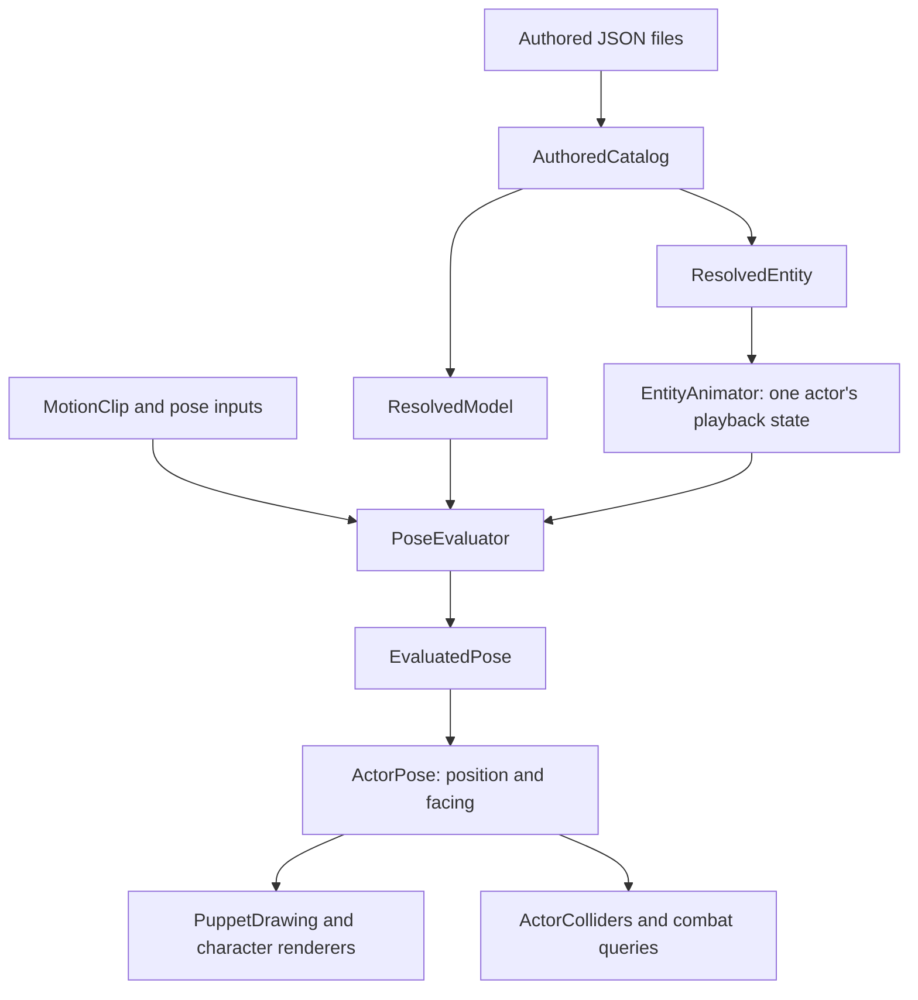

# Character system: vocabulary, flow, and source map

This is the current system guide. Start here to understand how the saved assets,
runtime, Studio, generators, and diagnostics fit together.

The source organization separates **definitions**, **resolution**, **evaluation**,
**live state**, and **authoring tools**. This organization pass preserves the C#
implementations, type names, namespaces, project references, and asset formats.
Folders describe responsibility; existing namespaces have deliberately been kept.
In particular, `App2d.Core.Characters.Authored` still contains both definition and
runtime types. `ClipAuthoring` and `PuppetImport` also retain that namespace while
being compiled into the Studio project. Project membership determines the assembly.

## The main idea

A character combines a model, reusable Parts, animation clips, and optional gameplay
behavior. Studio edits the same definitions that the game loads. Resolution prepares
those definitions for reuse. Evaluation produces a pose for one instant. A running
actor adds playback state, position, facing, and registered colliders.

Direct previews can sample a model and clip without an `EntityAnimator`. Static or
animated world Parts can use the shared Part drawing and physics paths without
being character actors.

## Shared vocabulary

| Term | Meaning here | Main types |
| --- | --- | --- |
| Definition | Editable data describing an asset or part of an asset. It can validate itself and contain convenience operations. | `CharacterModel`, `Part`, `MotionClip`, `ModelVariant`, `Behavior` |
| Asset | A saved definition with a stable ID, format/version, and references to other assets. | Files under `Assets/Characters/authored` |
| Model / rig | Controls, their relationships, dimensions, constraints, sockets, artwork, and motion sets. | `CharacterModel` |
| Control / node | A named element of the rig. A point control authors a rest point; a bone control authors a parent-local setup and optional length/link. Both are supported current data. | `ModelControl`, `RigSetup`, `RigLink` |
| Constraint / IK chain | A declared relationship that solves controls toward a target. The current rig solver handles declared two-bone constraints and contact pins. | `ModelChain`, `RigConstraintEvaluator`, `BoneFrameIk` |
| Socket | A named mount carried by the rig, with its own offset, orientation, layer, and optional Part usage contract. | `ModelSocket` |
| Part asset | Reusable content: geometry, materials, locations, and optionally a rig, clips, layers, expressions, behavior, motion, or physics. | `Part` |
| Geometry entry / piece | One drawable and/or collidable entry inside a Part or model. A Part can contain many pieces. | `PartGeometry`, `PartMesh` |
| Part instance / attachment definition | A saved occurrence of a Part on a model: asset ID, instance ID, socket, fit, transform, and overrides. This is definition data despite the word *instance*. | `PartInstance` |
| Resolved data | References and defaults prepared and checked for a particular definition/build. Generally cached and reused across actors or preview samples. | `ResolvedModel`, `ResolvedAttachment`, `ResolvedEntity`, `ResolvedCollider` |
| Evaluated pose | The result at one instant: control placements, angles, appearance, nested Part poses, travel, and constraint results. | `EvaluatedPose`, `EvaluatedControl2D`, `EvaluatedAttachment` |
| Placed actor pose | An evaluated pose carried into the world by the actor's position and facing. | `ActorPose` |
| Live actor state | Values that advance independently for each actor: role/action time, contact anchors, event crossings, hit history, collider registration. | `EntityAnimator`, `ContactHold`, `ActorColliders`, `HitLedger` |
| Variant / build | A reference to a base model plus parameter values and property overrides/clears. It reuses the base structure and clips. | `ModelVariant` |
| Parameter | A named input with defaults, limits, and bindings to declared properties. Presets are named collections of input values. | `ModelParameter`, `ParameterBinding`, `ParameterPreset` |
| Property reference / override | A typed target and a number, flag, selection, material, or clear operation. | `PropertyRef`, `PropertyOverride`, `RigProperties` |
| Clip / track / key | A clip groups timed channels and events. A track targets a particular value. A key supplies its time, value, and outgoing interpolation information. | `MotionClip`, `ClipTrack`, `ClipKey`, `SlotColorTrack2D` |
| Role | A semantic motion name such as idle, walk, or attack, bound to an actual clip. | `MotionSet`, `RoleClip`, `GameProfile` |
| Action | A gameplay sequence with a clip, optional mask/blending, hit windows, events, and optional projectile/recovery/chaining. | `EntityActionDef`, `ResolvedAction` |
| Expression | A semantic request that a Part binds to a clip, held pose, visibility, and/or layer muting. | `PartExpression`, `PartPlay` |
| Template | A creation recipe over existing assets: model, clips, dimensions, presets, and slot/library contracts. Instantiation makes independent drafts. | Studio's `ModelTemplate` |
| Seed / generator | C# authoring code that creates or publishes ordinary asset definitions. | `PersonTemplate`, `QuadrupedTemplate`, `PterosaurTemplate`, `PlayerMoves` |
| Document / workspace / session | Respectively: an editable asset and its history; the loaded draft collection and dependencies; selection, transport, commands, and preview state. | `AssetDocument`, `AuthoringWorkspace`, `EditorSession` |
| Smoke / proof / study | An explicitly run diagnostic, image capture, or scenario used to inspect behavior. It is separate from ordinary asset loading and editing. | `EditorSmoke`, `ProofRenders`, rendering smokes and studies |

An **entity** is currently a `Part` with `Behavior`; there is no separate saved
`EntityAsset` type or entities directory. A **prop**, **clothing item**, and **rig
module** can all be Part assets with different contents and usage. A **skin/slot**
is the named appearance-selection mechanism; it is distinct from a saved
`PartInstance` mounted on a socket.

The enum named `Workspace` selects Studio's Model/Animate/Entity/Appearance view.
It is distinct from the `AuthoringWorkspace` that owns loaded documents.

## Saved assets and loading

The authored library is [Assets/Characters/authored](../Assets/Characters/authored).

| Asset folder | Definition | Responsibility |
| --- | --- | --- |
| `geometry/` | `GeometryAsset2D` | Named local shape, curve or mesh without material or attachment |
| `render-materials/` | `RenderMaterialAsset2D` | Independently reusable rendering surface |
| `pieces/` | `Piece` | One drawable: geometry/material references or inline data, local transform, groups, default attachment |
| `models/` | `CharacterModel` | Rig, dimensions, artwork, sockets, attachments, motion sets |
| `variants/` | `ModelVariant` | A particular build of a base model |
| `animations/` | `MotionClip` | Standalone clips for model rigs |
| `parts/` | `Part` | Reusable parts, animated modules, characters, props, and clothing |
| `profiles/` | `GameProfile` | Player roles/gear and world-spawn bindings |
| `templates/` | Studio's `ModelTemplate` | New-model creation recipes and contracts |

Animated Parts can also own clips within their own file. Their IDs and targets
belong to that Part's rig rather than the standalone model clip catalog.

A static **Piece** attaches directly through the existing `PartInstance` placement
path. Catalog/workspace resolution prepares its geometry and material into the shared
runtime Part representation; this never creates a wrapper Part file or copies the
resources into the saved wearer. Source Piece definitions retain their references.
The workspace tracks geometry/material dependencies and invalidates wearer/entity
previews after changes or undo. Runtime catalogs also expose prepared Pieces through
the Part lookup used by equipment and attachment resolution.

`Piece.Game.Equipment` opts a static Piece into the game's standard Person inventory.
Its slot maps to two mounts; `Replace` selects overlay versus per-player artwork
replacement. `PersonEquipment` owns the humanoid conventions, while the renderer
accepts anatomy-independent `CharacterArtworkOverrides` and ordinary resolved
attachments. No model or evaluated pose is mutated to equip or unequip an item.

[AuthoredCatalog](../App2d.Core/Characters/Assets/AuthoredCatalog.cs) reads the
runtime definitions, checks references, caches model resolutions, and compiles
behavior-bearing Parts into resolved entities. Studio additionally loads templates
through `ModelTemplateCatalog`. `AuthoredAsset` supplies common parsing/ID/write
rules; `AuthoredJson` supplies the file contract and authored component encoding.
Current versions and unknown-member checks remain enforced by the loaders.

Asset IDs, control IDs, instance IDs, socket IDs, and action IDs serve different
scopes. For a nested animated Part, `instance/target` qualifies a target in the
wearer's channels. A file path locates a definition; an ID identifies it within
the relevant library or rig.

## Definitions, parameters, and resolution

[Definitions](../App2d.Core/Characters/Definitions) groups the editable vocabulary:

| Folder | Contents |
| --- | --- |
| `Models/` | The base model and variants |
| `Rig/` | Controls, bone setup/link/limit declarations, constraints, sockets, planar authored points |
| `Parameters/` | Parameter bindings/presets, property references, overrides, and the property registry |
| `Parts/` | Part assets and saved instances, geometry entries, meshes, paint, point bindings |
| `Library/` | Independently saved geometry, render materials, and static Pieces |
| `Appearance/` | Materials, texture frames, slots/skins, held appearance keys |
| `Animation/` | Motion clips, numeric/color keys, curves, and channel meanings |
| `Behavior/` | Behavior/action definitions, collider vocabulary, game-profile bindings |

[Runtime/Resolution](../App2d.Core/Characters/Runtime/Resolution) prepares these
definitions. `ParameterCatalog` validates and orders bindings. `RigLayout` holds
the resulting setup/property values. `ResolvedModel` builds the rig and prepared
artwork/attachments for a base or variant. `ResolvedAttachment` joins a saved
instance to its Part and mount. `ResolvedEntity` resolves roles, actions, geometry,
equipment, controller configuration, and collider definitions.

A variant can change a parameter or override a property. A clear operation has its
own defined meaning; it is not interchangeable with setting an arbitrary zero.
`PropertySource`/provenance reports whether the effective value came from the base,
a binding, an override, or a clear. Those are setup/build properties. An animated
channel has its own target and value semantics; a registered property is not
automatically an animation channel.

`PartInstance` belongs under definitions because it is saved placement data.
`ResolvedAttachment` belongs under resolution because it holds checked references.
`EvaluatedAttachment` belongs under poses because its placement and playback result
depend on the current sample. These three names describe different stages of the
same attached Part.

## Animation and poses

[MotionClip](../App2d.Core/Characters/Definitions/Animation/MotionClip.cs) contains
numeric tracks, travel, contacts, expression selections, slot/color/attachment
timelines, draw order, markers, and events. Translation, rotation, scale, artwork
fit, tint, alpha, visibility, IK targets, and socket orientation have explicit
channel semantics. The keys are ordered lists; a track is not a live playback clock.

The reusable mechanics live outside Characters in
[Core/Animation](../App2d.Core/Animation): `ITimedKey`, `IEditableTimedKey`,
`KeyframeSampling`, `KeyframeEditing`, `KeyframeSegmentSampler`, and ordinary frame
animation. Playback clocks live in `Core/Timing`. Character tracks supply their value-specific rules.
Held values use the shared key/segment rules. Continuous curves may use absolute
value handles, overshoot, and independent timing per component. Angles retain full
turns; an angle is not reconstructed from a matrix when that would lose winding.

[PoseEvaluator](../App2d.Core/Characters/Runtime/Poses/PoseEvaluator.cs) samples a
resolved model at a supplied time. Its inputs can select expressions/skins, request
in-place travel, provide contact anchors, or layer masked clips. Numeric layers
blend before the rig constraints are solved. Nested animated Parts use their
declared shared, mapped, or local clocks and evaluate into `EvaluatedAttachment`s.

`EvaluatedControl2D` stores each control's placement and unwrapped angle.
`EvaluatedPose` exposes that result, appearance, nested poses, travel, and constraint
diagnostics. Its points/bones/angles views are projections over the evaluated
controls. Sampling supports deterministic seeking and previews; it does not itself
own the game's movement or a per-actor event history.

[Runtime/Rig](../App2d.Core/Characters/Runtime/Rig) contains the compiled `RigNode`
graph, hierarchy compilation, constraint evaluation, and the two-bone solver.
Authored point controls and bone controls share the evaluated placement path.
Bone setup uses uniform scale/reflection; nonuniform artwork fit is a separate
leaf operation. The [constraint evaluator](../App2d.Core/Characters/Runtime/Rig/RigConstraintEvaluator.cs)
and [parameter catalog](../App2d.Core/Characters/Runtime/Resolution/ParameterCatalog.cs)
own the current constraint and parameter rules.

## Live actors, behavior, and collision

[EntityAnimator](../App2d.Core/Characters/Runtime/Animation/EntityAnimator.cs) owns
one actor's role/action clocks, event crossings, and world contact anchors. Its
`Step` advances playback using the movement/controller inputs it receives. The
controller owns the actor's movement. A masked action can play over locomotion
without taking over the legs' clock and contact anchors.

`ActorPose` combines a local evaluated pose with world position and facing. It
provides socket and control placement to drawing, equipment, and collision.
`EntityReaction` applies the supported reaction request to that playback state.

[ActorColliders](../App2d.Core/Characters/Runtime/Collision/ActorColliders.cs)
registers one actor's colliders and synchronizes them from the authoritative pose.
`ResolvedCollider` describes their shared prepared geometry/binding; an
`AttachedCollider` is a particular registration. `EntityRegion` is a placed shape
value used for queries/outlines. `CombatContacts` and `HitLedger` handle accepted
contacts and per-attack deduplication.

The game hosts remain in `App2d`: enemy actors, player animation/presentation,
combat, world placement, and physics integration. They consume Core definitions
and runtime objects. `GameProfile` supplies the authored player-role, gear, and
spawn bindings. `Conventions/` holds the Person/humanoid naming and loadout helpers;
the anatomy-independent evaluator does not require those names.

## Geometry, appearance, and rendering

`PartGeometry` is one shared entry for planar shapes/curves, images, or meshes.
Its placement, material, visibility, and optional collision declaration travel
together. `PartMesh` owns indexed geometry and optional editable extrusion outlines.
`PartPaint` and `PartPointBinding` are shared current data, even though they
previously lived beside the prototype puppet definition.

[Geometry](../App2d.Core/Characters/Geometry) places artwork on controls, applies
bindings, constructs contours, and bridges planar placements to physical 3D prop
frames. [Drawing](../App2d.Core/Characters/Drawing) turns evaluated content into
meshes and texture batches. `PuppetDrawing` is the retained name for this shared
Part/model/entity drawing path. GPU-facing meshes, shaders, and renderers live in
[Core/Rendering/Characters](../App2d.Core/Rendering/Characters), including
`PartShader2D` for a standalone placed Part.

Drawing layer and physical Z are separate. `LayeredFrame2D` carries XY placement
plus compositing order. Mesh/location XYZ values can describe real spatial geometry;
the planar rig's packed point Z carries its drawing layer. Sockets can lift into
real 3D orientation for equipment. See the
[geometry and drawing-order guide](../App2d.Core/Characters/README.md) for the exact
coordinate conventions.

Materials share fill, stroke/outline, paint, tint, alpha, images, and timed texture
frames. Geometry has no material by default: `Material = null` keeps collision-only
entries invisible. Visible geometry receives an explicit material. The reusable
`RenderMaterialDefinition2D.Ink` stroke and `RenderOutlineDefinition2D.Ink` outline
are authoring presets, assigned where wanted; they are never renderer fallbacks.
Models and Parts have no separate ink color or line width. Missing fill or outline
does not draw that surface; partial named-material overrides still inherit from
their selected material.

A texture source region is an `AxisAlignedRectangle2D`; UV creation and
validation belong to that rectangle's API. The world-space image rectangle and its
UV source region have independent sizes. Concrete geometry JSON omits the kind
tag; interface-typed geometry retains the tag needed to select its concrete type.

## Studio: documents, commands, and UI

Studio references Core, the game, and `App2d.EditorUi`. The game does not reference
Studio. Studio's editor, seeds, importers, arena, and diagnostics are folders within
the same executable project; no new assemblies were introduced by organizing them.

| Studio folder | Responsibility |
| --- | --- |
| `Editing/Documents/` | `AssetDocument` snapshots/undo/save state and `AuthoringWorkspace` drafts, references, validation, and resolution caches |
| `Editing/Session/` | `EditorSession` commands, selection/view mode, and `Transport` |
| `Editing/Preview/` | Sampled `Subject`/`EntityPreview` values, source-motion preview, picking |
| `Editing/BehaviorSchema.cs` | Typed field metadata shared by behavior editing |
| `Authoring/Models/` | Model/rig structural edits and conversions |
| `Authoring/Animation/` | `Channel` and `ClipAuthoring` key/curve/contact edits |
| `Authoring/Parts/` | Part geometry construction and appearance creation/duplication |
| `Authoring/Entities/` | Entity/action/collider authoring and queries |
| `Templates/` | JSON model-template contracts/catalog and look presets |
| `Importing/Library/` and `Importing/Puppet/` | Source readers and import/conversion into ordinary authored assets |
| `Preview/Arena/` | The interactive authoring arena, its drawing, and its editor host |
| `Editor/Shell/` | Application/window shell, asset browser, and Studio theme |
| `Editor/Views/` | Model, Animate, Entity, and Appearance workspace views |
| `Editor/Model/` and `Editor/Animation/` | Feature-specific inspectors, tools, overlays, and timeline/curve controls |
| `Editor/Components/` and `Editor/Viewport/` | Shared UI pieces and 2D/3D viewport support |
| `Seeds/` | Explicit asset generation/publication |
| `Diagnostics/` | Explicit smoke runs, captures, measurements, and studies |

The normal edit flow is:

1. `AuthoringWorkspace` opens the library into `AssetDocument`s.
2. `EditorSession` owns the current selection, transport, commands, and preview.
3. UI components request edits through the session/document path; authoring helpers
   perform the requested definition edits.
4. Document changes receive undo history and increasing versions. The workspace
   uses those versions/dependencies to rebuild affected resolved data and previews.
5. Preview samples feed the same Core pose/geometry/drawing code that runtime hosts use.
6. Save writes the authored definitions; selection, open views, and playback clocks
   remain session state.

Shared ImGui controls and UI infrastructure stay in `App2d.EditorUi`. A character
inspector that knows about controls, clips, or Parts belongs in Studio's editor.

## Templates, seeds, imports, and diagnostics

A **model template** is data over existing resources. Studio's New dialog discovers
template JSON, checks its slot/dimension/library contracts, and copies the source
model and clips into independent drafts. A **seed** is C# that constructs or
publishes those ordinary resources. A generated Person is not a separate runtime
subclass of a generic character.

| Area | Contents |
| --- | --- |
| `Seeds/Templates/` | Person/build, quadruped, and pterosaur generators; publication and source-resource helpers |
| `Seeds/Library/` | Starter entities/content, Parts, wardrobe, and procedural face assets |
| `Seeds/PlayerMoves/` | Move construction, weapon/spell assets, and swing variants |
| `Seeds/Modules/` | Module extraction/plans and the centaur composition study |
| `Seeds/Prototype/` | Prototype puppet study definitions and pose construction used by generation/import checks |
| `Seeds/SeedWriting.cs` | `SeedReport`: explicit writes, unchanged output, edited-file preservation, and forced replacement |
| `Diagnostics/Editor/` | Studio acceptance/surface/texture smokes and map-editor UI smoke |
| `Diagnostics/Proofs/` | `ProofRenders` and its character/motion/weapon/wardrobe/spatial capture modes |
| `Diagnostics/Rendering/` | Rendering smoke entry point and game/character/face/object/terrain/effect captures |
| `Diagnostics/Studies/` | Combat, hitstop, platform, and giant-tree scenarios |
| `Diagnostics/Support/` | Traversal manifest loading and retained character performance measurements |

`ModuleConversion` extracts/composes current asset resources. `RigConversion`
changes the authored rig representation during an explicit edit/import operation.
These uses of *conversion* are distinct from supporting old file-format versions.
`PuppetDefinition` remains the prototype/import data format in Core's `Prototype/`;
the shared `PuppetPoint` used by current model data lives under `Definitions/Rig/`.

Seed writing is explicit. Existing output that differs from a generator is kept
unless a forced generation is requested. Merely opening Studio or loading the game
does not regenerate the library. `MigrationMeasurements` retains its historical
name but measures the current catalog/evaluation/arena path.

Run Studio with `dotnet run --project App2d.CharacterStudio`. The unchanged command
entry points are in `Program.cs` and `Seeds/SeedCommands.cs`. For examples and visual
workflows, see [Character Studio](character-studio.md).

## Where to start for a change

| Question | Start here |
| --- | --- |
| What is saved in a model, Part, or clip? | `Core/Characters/Definitions/`, then `Assets/AuthoredCatalog.cs` |
| Why does a variant change this value? | `Definitions/Parameters/`, then `Runtime/Resolution/` |
| Why is this control/IK target in this position? | `Definitions/Rig/`, `Runtime/Rig/`, then `Runtime/Poses/PoseEvaluator.cs` |
| How are keys found, moved, held, and interpolated? | `Core/Animation/`, `Definitions/Animation/`, then Studio's `Authoring/Animation/` |
| Why does one actor play or emit a hit/event now? | `Runtime/Animation/`, `Runtime/Collision/`, then the game host/controller |
| Why does a piece look, crop, or attach this way? | `Definitions/Parts/`, `Definitions/Appearance/`, `Geometry/`, and `Drawing/` |
| How does an editor operation undo/save/refresh? | Studio's `Editing/Documents/`, `Editing/Session/`, then the relevant `Authoring/` helper and `Editor/` inspector |
| Where is a built-in Person, move, outfit, or template produced? | Studio's `Seeds/` and `Templates/`, plus the actual authored JSON |
| Where is a smoke image or scenario produced? | Studio's `Diagnostics/` |

Existing automated checks remain in `App2d.Tests` (not moved in this pass).
`Authored/` covers definitions, resolution, poses, edits, assets, and reference
captures; `Geometry/`, `Curves/`, `Animation/`, `Rendering/`, and game simulation
suites cover the adjacent layers. The historical `MigrationReferenceTests` still
checks current evaluated poses, collision, and combat against recorded results.

For future discussion, name the stage first: **definition**, **resolved data**,
**evaluated pose**, **live actor state**, **editor draft**, or **generator**. That
makes a proposed simplification concrete: which responsibility moves, which rule
has two owners, and which feature still needs that distinction?
